# SlotMate

**Live site: <https://slotmate-lac.vercel.app>** (Stripe runs in **test mode only**: no real money is ever taken; use Stripe's test card `4242 4242 4242 4242`).

SlotMate is a booking and resource-management web app. An **owner** creates workspaces and the things people can book (rooms, desks, equipment, appointments), sets when each one is open, and shares a public page where **visitors** request a time slot without creating an account. The owner approves or rejects each request from a dashboard. Paid plans raise the limits and unlock more analytics and a customizable website widget.

This is also a learning project: the owner is learning software engineering and working with AI coding agents. The honest story of what went well and what went wrong is in [`docs/DEVELOPMENT_LOG.md`](docs/DEVELOPMENT_LOG.md).

> **Status: the app is built, tested and deployed (Phases 1 to 17 and the deployment part of Phase 18).** 82 of the 85 requirements are done, 3 are partly done and none is missing (all 74 Must-haves are done); see [`docs/REQUIREMENTS_CHECKLIST.md`](docs/REQUIREMENTS_CHECKLIST.md) for the status and the evidence of each one. No demo video is included: the [screenshots](#screenshots) show the app instead (a demo script exists in [`docs/DEMO_SCRIPT.md`](docs/DEMO_SCRIPT.md)). My written reflection is [`docs/REFLECTION.md`](docs/REFLECTION.md), and every course deliverable is listed in [`docs/SUBMISSION_CHECKLIST.md`](docs/SUBMISSION_CHECKLIST.md).

## Screenshots

Taken from the real app (the landing page from the live site, the rest with throw-away demo data; no real people or addresses).

**Landing page (live site)**

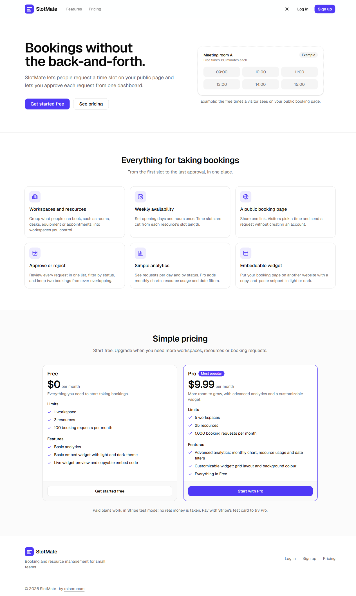

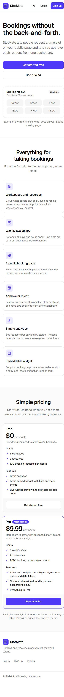

| | |
|---|---|
| **Public booking page on a phone (375 px).** A visitor picks a resource, a date and a time, and sends a request without an account. | 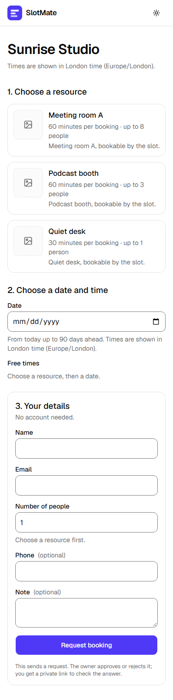 |

**Public booking page on a desktop (1280 px)**

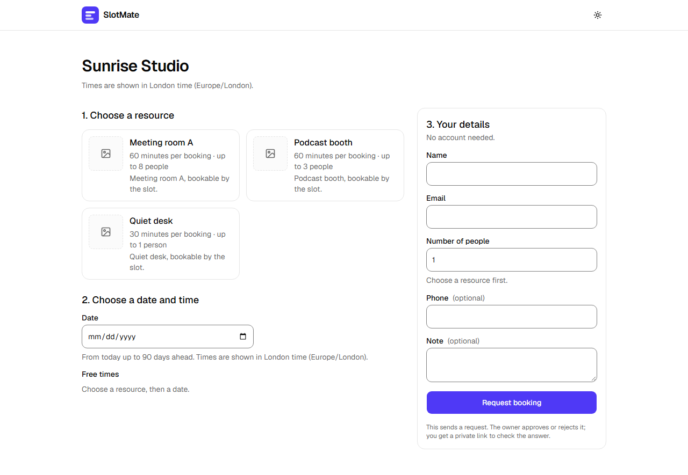

**Booking status page:** the visitor's private link, first pending, then approved after the owner decides.

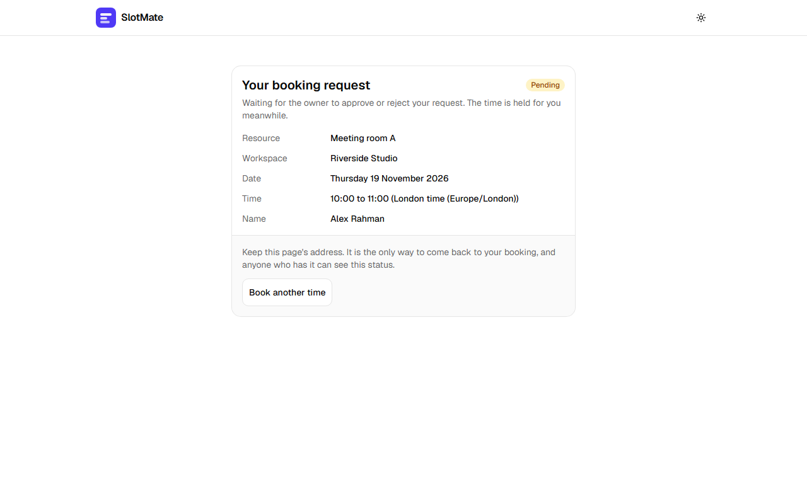

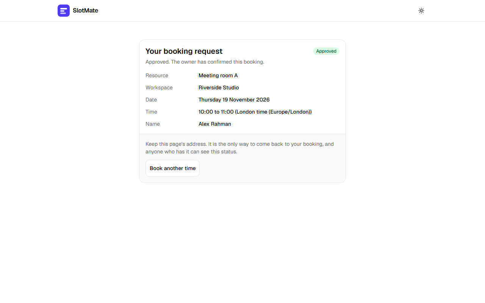

**Dashboard overview:** counts, plan usage, the 30-day chart, requests waiting for a decision.

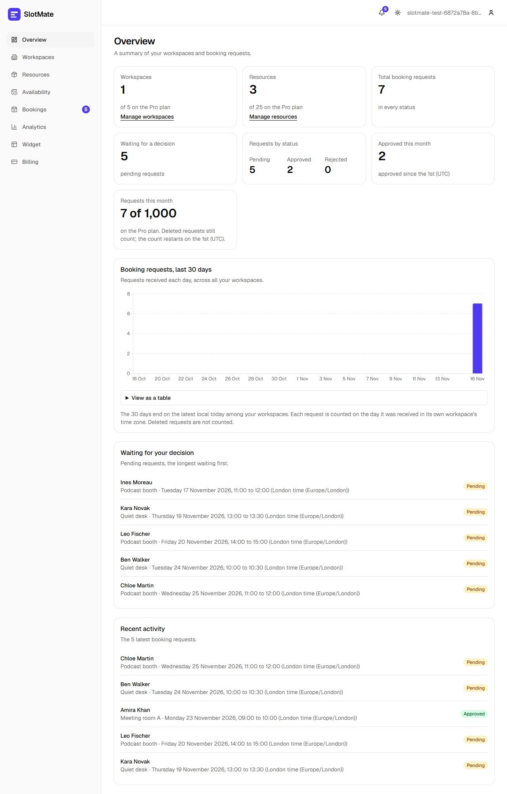

**Bookings list:** filter by status, search, approve, reject, cancel or delete.

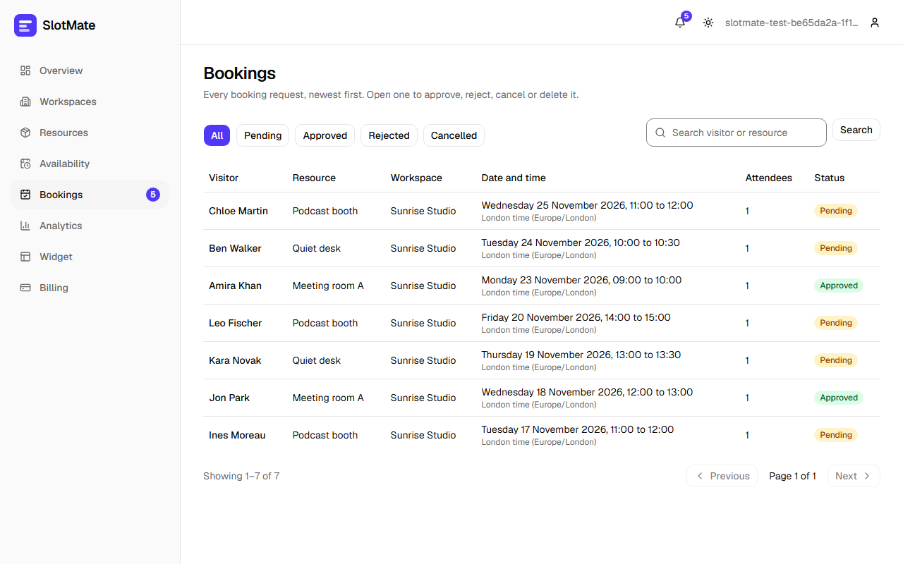

**Analytics (Pro):** requests per day, by status, per month and per resource, each with a text table.

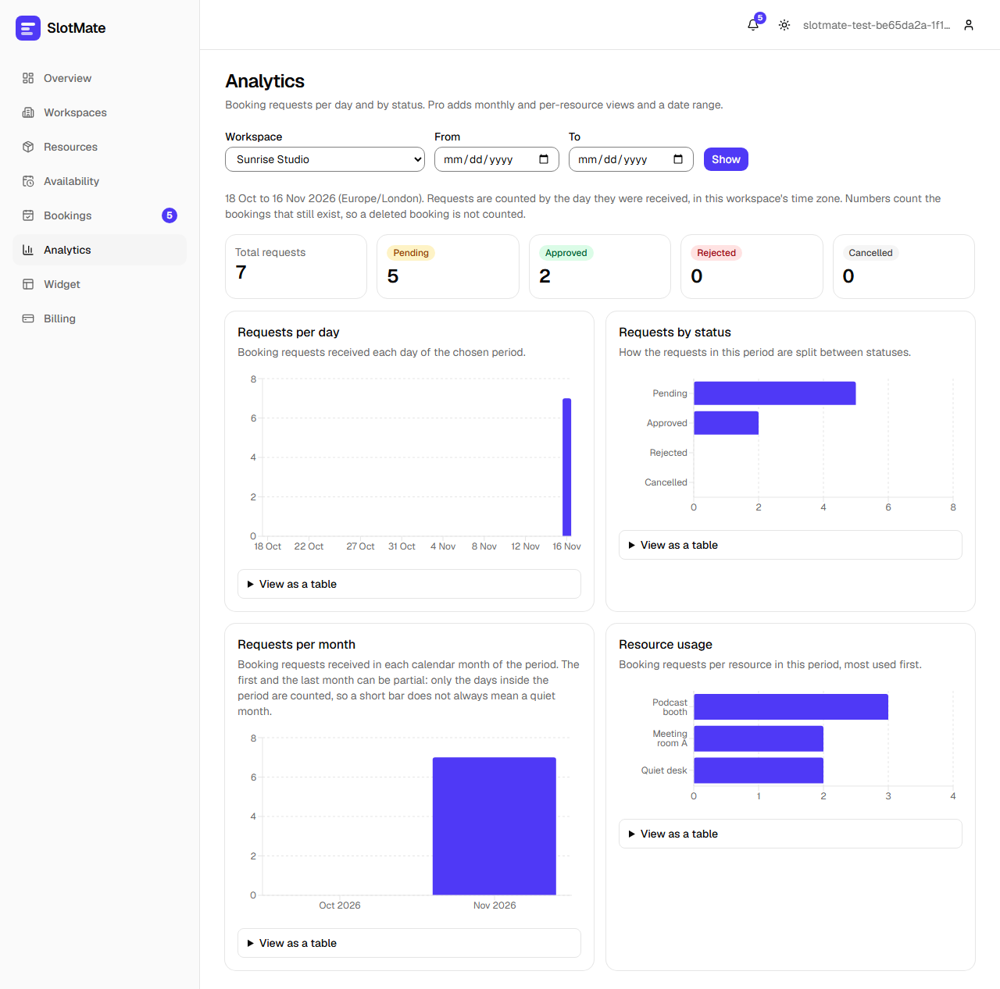

**Widget settings:** theme, Pro-only layout and colour, a live preview of the saved options and the copyable embed code.

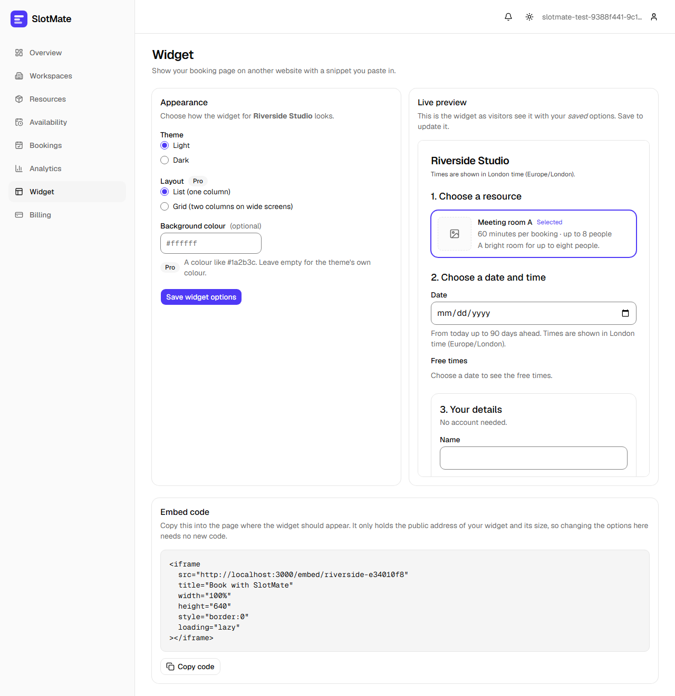

**Embeddable widget:** the booking flow as it appears inside an iframe on another website.

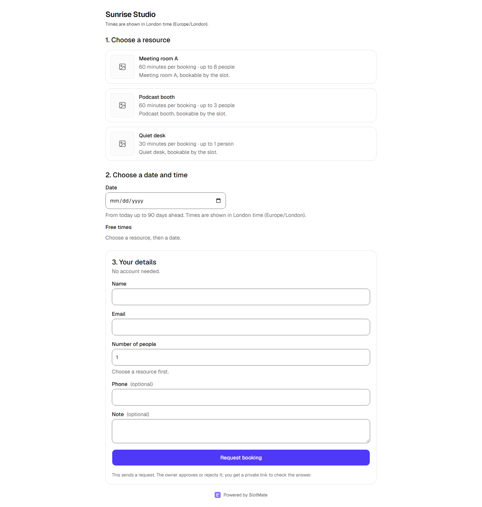

**Billing:** current plan, usage against the limits, and the two plans (Stripe test mode).

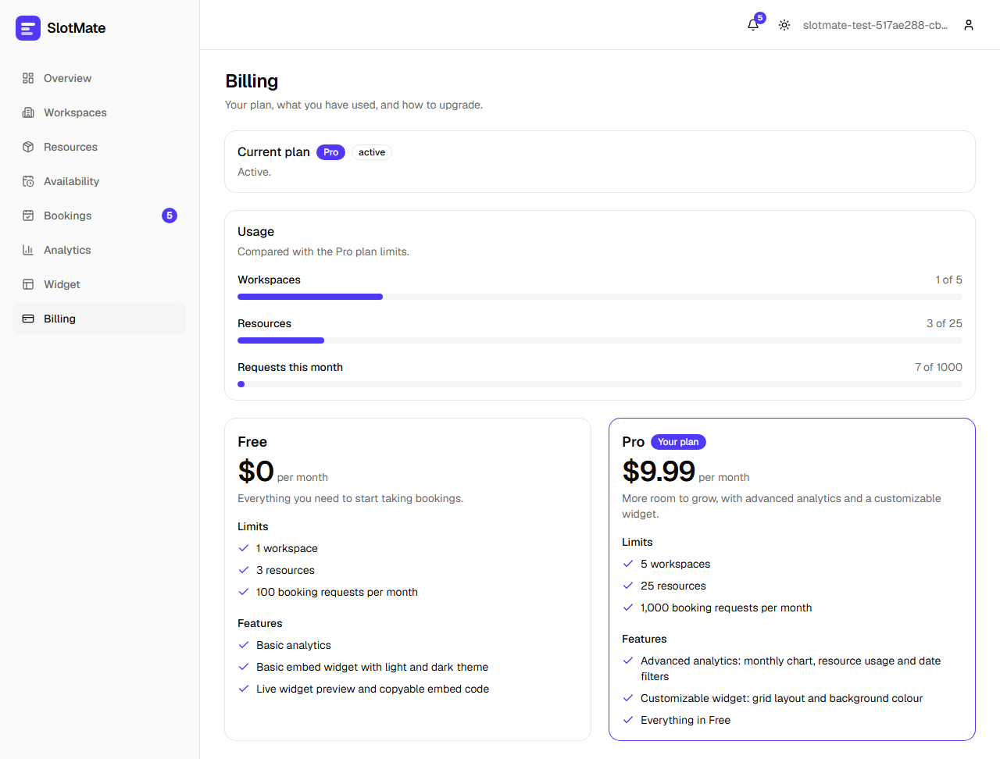

## Features

Requirement IDs are in [`docs/PROJECT_REQUIREMENTS.md`](docs/PROJECT_REQUIREMENTS.md).

- **Accounts** for owners: register with email confirmation, log in, log out, password recovery, a protected dashboard.
- **Workspaces** (one place an owner manages, with its own public address and time zone) and **resources** (a bookable thing with a description, an image, a fixed slot length and a capacity).
- **Weekly availability** per resource: open weekdays and hours; slots are cut from the slot length in the workspace's time zone. Two bookings can never overlap, even when requests arrive at the same moment.
- **Public booking page** per workspace: visitors choose a resource, a date and a time, give their details and submit, with no registration. A private status link shows the request's state. A rate limit protects the form.
- **Booking management**: list, details, approve, reject, cancel an approved booking, delete, filter by status, search by visitor or resource, a pending badge.
- **Analytics** with charts (each has a text table) and a 30-day chart on the dashboard overview.
- **Embeddable widget** (an iframe) with a live preview and copyable code.
- **Billing** with Stripe (test mode): upgrade through Checkout, manage or cancel through the Customer Portal, a signed webhook, and a safe downgrade where nothing is deleted.

### Free and Pro plans

- **Free**: 1 workspace, 3 resources, 100 booking requests per month, basic analytics, basic embed widget (light or dark theme).
- **Pro** ($9.99 per month): 5 workspaces, 25 resources, 1,000 booking requests per month, advanced analytics (monthly chart, resource usage, date filters) and the customizable widget (grid layout, background colour).

The limits are enforced in the database, not only in the interface. If an owner downgrades, nothing is deleted: the owner chooses one workspace and up to three resources to keep active, and the rest become read-only until the owner deletes some or upgrades.

## Features: done and not done

Status of the 85 requirements in [`docs/REQUIREMENTS_CHECKLIST.md`](docs/REQUIREMENTS_CHECKLIST.md), which gives the evidence (test titles or a dated manual check) for every one. **82 are done, 3 are partly done, none is missing; all 74 Must-haves are done.**

| Area | Name | Requirements | Done | Partly done |
|---|---|---|---|---|
| ROLE | Roles (owner, visitor) | 2 | 2 | 0 |
| AUTH | Authentication | 6 | 6 | 0 |
| DASH | Dashboard | 6 | 6 | 0 |
| WORK | Workspace management | 4 | 4 | 0 |
| RES | Resource management | 8 | 8 | 0 |
| AVAIL | Availability | 5 | 5 | 0 |
| PUB | Public booking page | 7 | 7 | 0 |
| BOOK | Booking management | 8 | 8 | 0 |
| NOTIF | Notifications | 3 | 3 | 0 |
| ANLT | Analytics | 6 | 6 | 0 |
| EMBED | Embed widget | 7 | 6 | 1 |
| BILL | Subscription and billing | 9 | 9 | 0 |
| SEC | Security | 6 | 6 | 0 |
| ISO | Data isolation | 3 | 3 | 0 |
| PERF | Performance | 3 | 1 | 2 |
| RESP | Responsive design | 2 | 2 | 0 |
| | **All** | **85** | **82** | **3** |

**The three partly done requirements** (all three are Nice-to-haves):

| ID | Requirement | What is missing |
|---|---|---|
| EMBED-06 | Live widget preview | The preview is the real widget, but it shows the saved options and only updates after "Save widget options", not while the owner is typing (an owner decision on a true live preview is still open). |
| PERF-01 | Page load time | Measured pages load well under 3 seconds (about 0.3 to 0.4 s for public pages on the live site, about 0.9 s for the dashboard locally), but the dashboard and the booking list were not timed on the live site. |
| PERF-02 | Lists stay fast | Lists show 20 rows per page and are tested for paging, but there is no test with 1,000 bookings (the architecture document marks that test as optional). |

Known limits and open items: [`docs/REQUIREMENTS_CHECKLIST.md`](docs/REQUIREMENTS_CHECKLIST.md) section 5.

## Tech stack

- **Next.js 16** (App Router), **React 19**, **TypeScript**, **Tailwind CSS 4**
- **Supabase**: PostgreSQL with row level security, Auth, Storage (8 migrations, 11 tables)
- **Stripe** (test mode): Checkout, Customer Portal, signed webhook
- **Recharts** for charts, **zod** for input checks, **@date-fns/tz** time-zone helpers
- **shadcn/ui** (Radix UI and Lucide icons) for the interface components
- **Playwright** for unit, UI and database tests; **axe-core** for accessibility scans
- **Vercel** hosting (Singapore region), **Supabase CLI** for migrations and generated types

## Architecture in short

The browser never talks to the database. Pages and forms go through our Next.js server, which checks every rule; the database is the last line of defence and enforces the rules that matter most (data isolation, plan limits, no double booking, allowed status changes). Visitors have no database permissions at all: public pages are built by server code. Times are stored as exact moments, opening hours as plain clock times, and every workspace has a time zone name. More in [`docs/ARCHITECTURE.md`](docs/ARCHITECTURE.md) and [`docs/DATABASE.md`](docs/DATABASE.md).

## Words used in this README

- **Row level security (RLS):** rules inside the database that decide, row by row, who may read or change data.
- **Migration:** one SQL file that changes the database; the files run in order and are kept in Git.
- **Project reference:** the short code that identifies your Supabase project.
- **Publishable key and secret key:** Supabase's two API keys. The publishable key is safe to show but, on its own, grants nothing here. The secret key bypasses every security rule, so it stays on the server and out of Git.
- **Webhook:** a message that another service (here Stripe) sends to our server when something happens.
- **Iframe:** a way to show one web page inside another website; the embeddable widget uses it.
- **Server Action:** a server function that a form calls when it is submitted.

More definitions: [`docs/ARCHITECTURE.md`](docs/ARCHITECTURE.md) section 0 and [`docs/DATABASE.md`](docs/DATABASE.md) section 1.

## How to run the project

These steps set up your own copy against your own Supabase project. Do them **in this order**.

**You need:** Node.js 22 or newer, npm, Git, a free [Supabase](https://supabase.com) account, and (only for billing) a Stripe test-mode account.

1. **Clone and install.**

   ```powershell
   git clone https://github.com/raianrunam/slotmate.git
   cd slotmate
   npm install
   ```

2. **Create a Supabase project** for development (keep production separate). Save the database password somewhere safe. You also need the project's **reference** (the short code in the project's address) in step 4. Never put either in a file that is committed.

3. **Create `.env.local`** from the template and fill in the values. `.env.local` is ignored by Git; never commit it.

   ```powershell
   Copy-Item .env.example .env.local
   ```

   - `NEXT_PUBLIC_SUPABASE_URL`: Project Settings > Data API (or the Connect button).
   - `NEXT_PUBLIC_SUPABASE_PUBLISHABLE_KEY` and `SUPABASE_SECRET_KEY`: Project Settings > API Keys. The secret key bypasses all security rules: keep it server-side only.
   - `NEXT_PUBLIC_APP_URL`: `http://localhost:3000` while developing.
   - `RATE_LIMIT_SECRET`: a random string of at least 32 characters, for example from `node -e "console.log(require('crypto').randomBytes(32).toString('hex'))"`.
   - `STRIPE_SECRET_KEY`, `STRIPE_WEBHOOK_SECRET`, `STRIPE_PRO_PRICE_ID`: Stripe **test-mode** values. For the webhook on your own computer run `stripe listen --forward-to localhost:3000/api/stripe/webhook`; it prints the signing secret.

   The full list of names and what each is for: [`docs/ARCHITECTURE.md`](docs/ARCHITECTURE.md) section 7.

4. **Log in to the Supabase CLI and link your project.**

   ```powershell
   npx supabase login
   npx supabase link --project-ref <your-project-ref>
   ```

5. **Apply the database migrations** (this changes your Supabase project). Supabase CLI v3 needs `--remote`. Look first, then apply:

   ```powershell
   npx supabase db push --remote --dry-run
   npx supabase db push --remote
   ```

   This creates the 11 tables, the functions, the security policies and the image bucket (8 migrations in `supabase/migrations/`). A migration that has been pushed is never edited; a change is a new migration.

6. **Start the app.**

   ```powershell
   npm run dev
   ```

   Open <http://localhost:3000>.

### Supabase authentication settings

Set these once in your Supabase dashboard (Authentication). Nothing in the repository changes them.

- **Email confirmation** (Sign In / Providers > Email): on.
- **Minimum password length**: 8.
- **Site URL**: `http://localhost:3000` for development (your production address for a deployed copy).
- **Redirect URLs** (URL Configuration): `http://localhost:3000/**`. The sign-up and reset emails send the visitor to `/auth/confirm` on this address.
- **Email templates**: leave the defaults. SlotMate uses Supabase's default email links with the PKCE flow, so **a link must be opened in the same browser that asked for it**.
- **Secure password change** (recommended): on.
- Supabase's built-in email service sends only a few emails per hour. The automated tests never send email.
- **Do not run `supabase config push`** from this repository: `supabase/config.toml` differs from the live project and a push would, among other things, turn email confirmation off.

Deploying your own copy to Vercel: [`docs/DEPLOYMENT.md`](docs/DEPLOYMENT.md).

### Run the tests

Counts on 2026-11-16: **435 unit checks and 400 UI tests** (run after the final landing-page change, none failed, none skipped) and **94 database tests** (last run in Phase 17b, twice; not re-run since, because nothing in the database changed) (run against the development Supabase project; details and the known flaky cases in [`docs/TESTING.md`](docs/TESTING.md)).

```powershell
npm run test:unit      # 435 checks: input rules, time maths, source-code guards. No browser, server or database.
npm run test:ui        # 400 tests in Chromium at 375, 768 and 1280 px, including accessibility scans. Needs .env.local.
npm run test:db        # 94 tests of the database through real paths. Needs .env.local and the Supabase CLI login and link.
npx tsc --noEmit       # type check
npx eslint             # lint
```

- The first time, run `npx playwright install chromium` for the UI tests.
- `npm run test:ui` and `npm run test:db` create and delete throw-away test users (`slotmate-test-<random>@example.com`) in the Supabase project that `.env.local` points to. **Use a development project, never production.**
- Database tests use real paths only: the server key calling real functions, real logged-in owners, and the public key with no login. No direct Postgres connection and no extra grants to make a test pass.

## Other scripts

- `npm run build` and `npm run start`: build and run the production build.
- `npm run lint`: run ESLint.
- `npx supabase gen types --remote --lang typescript --schema public > src/types/database.types.ts`: regenerate the database types after a migration.

## Security model in plain words

- **Every table has row level security on.** An owner can only see and change their own rows (test T1 tries every table).
- **Strangers get nothing.** The public key gets no table privileges and cannot call any function; functions meant only for our server are closed to the browser roles (T2 to T7).
- **Owners cannot change their plan or their usage.** Only our server can, after checking a signed Stripe message and asking Stripe for the current subscription (T5, T15, T16).
- **No double booking.** The database refuses two pending or approved bookings that overlap on the same resource, tested with simultaneous requests (T8).
- **Plan limits and allowed status changes live in the database**, so a request that skips our pages cannot break them.
- **Sessions and secrets.** Session cookies are `Secure` and `HttpOnly` on the production site (checked by hand, 2026-11-16); the secret key and Stripe keys are used only in server code (guarded by tests); the public form has a per-visitor rate limit.
- The repository is public: no secret key, project reference or personal email address is committed, and the whole Git history was scanned (see [`docs/REQUIREMENTS_CHECKLIST.md`](docs/REQUIREMENTS_CHECKLIST.md) SEC-01).

## Agentic tools used and where

SlotMate was built with Claude Code. Each technique below is used for real in this repository; dates and proof for each are in [`docs/AGENTIC_TOOLS.md`](docs/AGENTIC_TOOLS.md), and the diary of what went well and what the agents got wrong is in [`docs/DEVELOPMENT_LOG.md`](docs/DEVELOPMENT_LOG.md). My written reflection is in [`docs/REFLECTION.md`](docs/REFLECTION.md).

| Technique | Where | How it was used |
|---|---|---|
| Project rules for agents | `AGENTS.md`, `CLAUDE.md` | Read at the start of every session; they hold the approval rules (no pushed-migration edits, no `git add -A`, no `.env` reading, ask before database changes). |
| Permission deny rules | `.claude/settings.json` | Block the agent from reading `.env*` files, so secrets never reach the conversation or the public repository. |
| Hooks | `.claude/hooks/protect-migrations.mjs`, `guard-bash.mjs`, `lint-after-edit.mjs`, `lib.mjs`; wired in `.claude/settings.json` | Deny edits to pushed migrations, ask before `supabase db push`, force-push and hard reset, deny commands that read env files, and run ESLint after every `.ts`/`.tsx` edit. 56 unit checks in `tests/unit/hooks.spec.ts`; a hook blocked the agent's own commands in Phase 16. |
| Custom subagents | `.claude/agents/security-reviewer.md`, `migration-reviewer.md`, `test-runner.md` | Two read-only reviewers for SQL, grants, policies, Server Actions and Stripe, and a test runner that never edits; the test runner produced the Phase 17b test counts. |
| Project skill | `.claude/skills/slotmate-phase/SKILL.md` | The phase workflow written once: plan, build, tests that can fail, fresh review, fix, docs, small commits, plus the approval rules and known traps. |
| Independent reviewer subagents | Reports in the owner's notes folder; findings in `docs/DEVELOPMENT_LOG.md` and `docs/AGENTIC_TOOLS.md` section 6 | Phases 4 to 17: after each build a fresh read-only subagent reviewed the real code and documents; almost every review found a real problem, for example the Phase 16 whole-app security review. |
| Parallel worktrees | Branches `feat/phase13-analytics` and `feat/phase14-widget` (merge commits `baae8aa`, `9c53394`) | Phases 13 and 14 were built at the same time by two subagents in two git worktrees (about seven minutes of overlap) and merged without a conflict; details in `docs/AGENTIC_TOOLS.md` section 7. |
| Playwright MCP server | `.mcp.json` (`@playwright/mcp@0.0.85`) | Registered in Phase 16; it could not connect in that session, and was used on 2026-11-16 to check the live site at 375 and 1280 px and to take the landing-page screenshots. |
| Playwright test runner | `tests/unit`, `tests/ui`, `tests/db` | All three test suites run through Playwright: 435 unit checks, 400 UI tests (with axe-core accessibility scans) and 94 database tests. |

## Documentation

- [`docs/MASTER_PROMPT.md`](docs/MASTER_PROMPT.md): the project brief and the 18 phases.
- [`docs/PROJECT_REQUIREMENTS.md`](docs/PROJECT_REQUIREMENTS.md): what the app must do.
- [`docs/REQUIREMENTS_CHECKLIST.md`](docs/REQUIREMENTS_CHECKLIST.md): every requirement with its status and its evidence.
- [`docs/ARCHITECTURE.md`](docs/ARCHITECTURE.md): how the parts fit together and where each security check happens (with diagrams).
- [`docs/DATABASE.md`](docs/DATABASE.md): tables, rules, functions, row level security, migrations (with an entity diagram).
- [`docs/TESTING.md`](docs/TESTING.md): how the tests work and what they prove.
- [`docs/DEPLOYMENT.md`](docs/DEPLOYMENT.md): how the live site is deployed and the checks run on it.
- [`docs/AGENTIC_TOOLS.md`](docs/AGENTIC_TOOLS.md): every agentic technique used, with evidence.
- [`docs/DEVELOPMENT_LOG.md`](docs/DEVELOPMENT_LOG.md): the development diary, including agent mistakes and open items.
- [`docs/DEMO_SCRIPT.md`](docs/DEMO_SCRIPT.md): the 3 to 4 minute demo script (no video was recorded; screenshots are used instead).
- [`docs/REFLECTION.md`](docs/REFLECTION.md): my reflection on building SlotMate with Claude Code.
- [`docs/SUBMISSION_CHECKLIST.md`](docs/SUBMISSION_CHECKLIST.md): every course deliverable and its status.
- [`AGENTS.md`](AGENTS.md) and [`CLAUDE.md`](CLAUDE.md): the rules AI coding agents follow in this repository.

## Folder structure

```
slotmate/
├── AGENTS.md, CLAUDE.md     Rules for AI coding agents
├── .claude/                 Claude Code settings, hooks, custom subagents and the phase skill
├── .mcp.json                Playwright MCP server
├── docs/                    Requirements, architecture, database, testing, deployment, log, screenshots
├── public/                  Static files (the embed theme scripts)
├── src/
│   ├── app/                 Next.js pages and routes: landing, auth, dashboard, booking, embed, API
│   ├── components/          ui/ (shadcn/ui) and the app's own components
│   ├── features/            One folder per feature area (auth, workspaces, resources, availability, ...)
│   ├── lib/                 Shared code: Supabase and Stripe clients, time and slot library, plans
│   └── types/               TypeScript types generated from the database
├── supabase/migrations/     The 8 database migrations (SQL, in order)
├── tests/db, ui, unit/      Database, user-interface and unit tests (Playwright test runner)
├── next.config.ts, vercel.json, eslint.config.mjs, tsconfig.json, package.json
└── .env.example             Environment variable names (no values)
```

## License

No license has been chosen yet.
