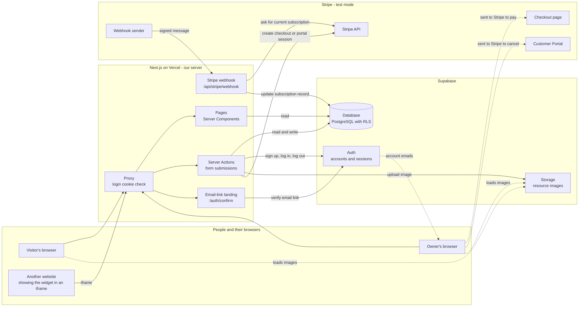
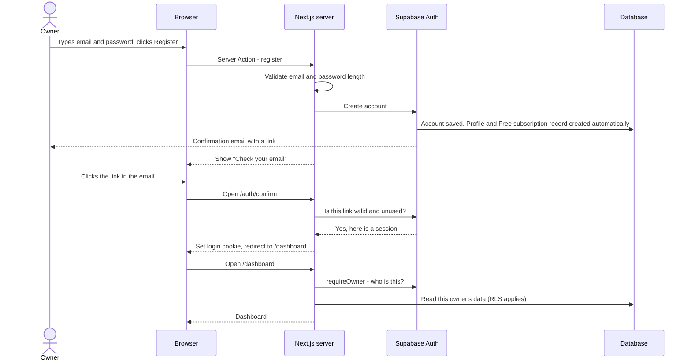
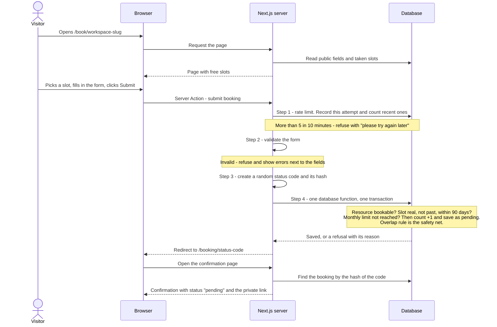
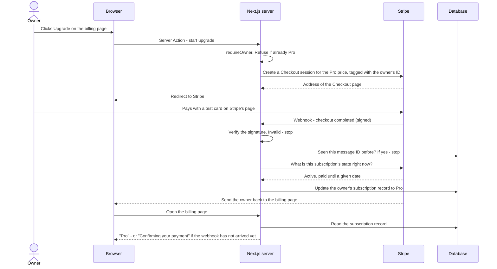

# SlotMate — Architecture

Last updated: 2026-11-12 · Phase 3 (Define architecture) · Sources: `docs/MASTER_PROMPT.md`, `docs/PROJECT_REQUIREMENTS.md`

---

## 0. How to read this document

The requirements document says **what** SlotMate must do. This document says **how the parts fit together**: which program does which job, where each security rule is enforced, and what we build first.

It does not design database tables. It only names which data exists. Tables, columns and database rules are Phase 4 (`docs/DATABASE.md`).

Requirement IDs such as `AUTH-04` and decisions such as `D7` refer to `docs/PROJECT_REQUIREMENTS.md`. Decisions numbered `A1`–`A20` and `L1`–`L7` are architecture decisions, listed in section 9.

### Words used in this document

| Word | Meaning |
|---|---|
| **Browser** | The program on the user's device (Chrome, Safari…). Anything that runs here can be read and changed by the user, so it is never trusted. |
| **Server** | Our Next.js program running on Vercel. Users cannot see or change its code. Rules checked here cannot be skipped. |
| **Server Component** | A piece of a page that is built on the server. It can read the database. Only the finished result is sent to the browser. |
| **Client Component** | A piece of a page that also runs in the browser, for things that react to clicks and typing (a date picker, a chart, a copy button). |
| **Server Action** | A server function that a form calls when it is submitted. All of SlotMate's changes to data go through Server Actions. |
| **Route Handler** | A plain web address on our server that another system can call. We have two: one for Stripe, one for email links. |
| **Proxy** | A small piece of code that Next.js runs before every request. Next.js 16 renamed "middleware" to "proxy"; the file is `src/proxy.ts`. |
| **Row Level Security (RLS)** | Rules inside the database that decide, row by row, who may read or change data. |
| **Transaction** | A group of database steps that either all succeed or all fail together. |
| **Webhook** | A message that Stripe sends to our server when something happens, such as a payment succeeding. |
| **Environment variable** | A named setting kept outside the code, used for addresses and secret keys. |
| **Hash** | A one-way fingerprint of a value. The same input always gives the same fingerprint, but the fingerprint cannot be turned back into the input. |

---

## 1. System overview



Solid arrows are requests made by our code. Dotted arrows are things that happen outside our server: the browser being sent to Stripe's pages, emails, and images loading.

### What each part does

| Part | Job | Who may talk to it |
|---|---|---|
| **Visitor's browser** | Shows the public booking page, the widget and the status page. | — |
| **Owner's browser** | Shows the dashboard. | — |
| **Next.js on Vercel** | Builds every page, checks every rule, and is the only program that holds secret keys. | Anyone on the internet, but dashboard addresses need a login. |
| **Supabase Auth** | Stores accounts and passwords, sends the confirmation and password-reset emails, and issues the login session. | Only our server. |
| **Supabase Database** | Stores all SlotMate data. RLS keeps each owner's rows separate. | Only our server (decision A1). |
| **Supabase Storage** | Stores resource images. | Anyone may read an image; only our server may add, replace or remove one (A15). |
| **Stripe API** | Creates checkout and portal sessions; tells us the current state of a subscription. | Only our server, using the secret key. |
| **Stripe Checkout and Customer Portal** | Stripe's own pages where the owner pays or cancels. Card numbers never reach SlotMate (BILL-04). | The owner's browser, after we send it there. |
| **Stripe webhook sender** | Tells our server about payments and subscription changes. | Calls one address on our server; we check its signature (SEC-04). |

The most important line in the picture is the one that is **missing**: there is no arrow from a browser to the database. Browsers only ever talk to our server (A1).

---

## 2. Folder structure under `src/`

```
src/
├── proxy.ts               Runs before every request. Keeps the login cookie fresh
│                          and sends logged-out people away from /dashboard.
│
├── app/                   Web addresses only. Each page file is short: it asks a
│   │                      feature for data and shows that feature's components.
│   ├── layout.tsx         The outer frame of every page.
│   ├── page.tsx           Home page.
│   ├── (auth)/            login, register, forgot-password, reset-password.
│   │                      The brackets mean the folder name is not part of the address.
│   ├── auth/confirm/      Route Handler. Where email links land (confirm sign-up,
│   │                      reset password).
│   ├── dashboard/         The protected owner area:
│   │                      overview, workspaces, resources, bookings, analytics,
│   │                      embed, billing.
│   ├── book/[slug]/       Public booking page for one workspace (PUB-01).
│   ├── booking/[token]/   Confirmation page and private status page (A8).
│   ├── embed/[slug]/      The widget. Has its own bare layout and is the only
│   │                      area allowed inside an iframe (EMBED-02).
│   └── api/stripe/webhook/  Route Handler. Receives Stripe's messages.
│
├── features/              One folder per requirement area:
│   │                      auth, workspaces, resources, availability,
│   │                      public-booking, bookings, analytics, embed, billing.
│   └── <area>/
│       ├── actions.ts     Server Actions: everything that changes data.
│       ├── queries.ts     Server-only reads from the database.
│       ├── schema.ts      The input rules for this area's forms, written once
│       │                  and used by both browser and server.
│       └── components/    This area's pieces of screen.
│
├── components/
│   ├── ui/                shadcn/ui components (buttons, dialogs, inputs…).
│   └── …                  Shared layout pieces: navigation, empty states.
│
├── lib/                   Shared plumbing used by several features.
│   ├── supabase/          How we connect to Supabase: one connection that acts
│   │                      as the logged-in owner, one "admin" connection that
│   │                      uses the secret key.
│   ├── stripe/            How we connect to Stripe.
│   ├── auth.ts            requireOwner(): "who is logged in?" (section 3).
│   ├── time/              Time zone and slot calculations (section 5).
│   ├── plans.ts           The plan limit numbers, in one place.
│   ├── rate-limit.ts      The public-form rate limit (section 6.3).
│   └── env.ts             Reads environment variables and fails loudly if one
│                          is missing.
│
└── types/                 TypeScript types generated from the database.
```

Outside `src/`:

| Path | Holds |
|---|---|
| `supabase/migrations/` | Database changes as SQL files, so every change is recorded in Git (L6). |
| `tests/` | Playwright tests. |
| `.env.example` | The environment variable **names** with no values (SEC-01). |
| `docs/` | This document and the other project documents. |

### Rules for what belongs where

1. **Pages stay thin.** A file in `app/` does not contain database queries or business rules. It calls a feature.
2. **Changes go in `actions.ts`, reads go in `queries.ts`.** If you want to know how bookings are approved, there is exactly one file to open.
3. **Server-only files:** every `actions.ts` and `queries.ts`, and `lib/supabase/`, `lib/stripe/`, `lib/auth.ts`, `lib/rate-limit.ts`, `lib/env.ts`. Each starts with a marker (L5) that makes the build fail if it is ever pulled into browser code.
4. **Shared files, safe on both sides:** every `schema.ts`, `lib/time/` and `lib/plans.ts`. They contain rules and calculations but no secrets and no database access.
5. **Features do not reach into each other.** The one planned exception is `embed`, which reuses the booking screens from `public-booking` so the widget and the public page behave identically (EMBED-01).
6. **The admin connection is used in six places only** (A4): public page reads, booking submission, the rate limit, the Stripe webhook, resource image uploads (A15), and saving the downgrade selection (A18). Everything else uses the connection that acts as the logged-in owner, so RLS applies.

Rule 5 is also what makes parallel development possible later (master prompt section 7): two people working on two features rarely touch the same file.

---

## 3. Browser or server, and where each security check happens

### 3.1 What runs where

| Runs in the browser | Runs on the server |
|---|---|
| Remembering what is typed in a form before it is sent | Every read from and write to the database |
| The date picker and slot buttons | Deciding which slots are free |
| Drawing charts (Recharts) from numbers the server sent | Calculating those numbers |
| The widget's live preview (EMBED-06) | Saving widget options |
| The "Copy" button (EMBED-07) | Building the embed code's address |
| Friendly, instant error messages next to fields | The checks that actually count |
| — | Everything that uses a secret key |

### 3.2 The principle

> Checks in the browser are for convenience. The server decides. The database is the last line of defence.

A browser check gives a fast, friendly message. It protects nothing, because a user can skip the web page and send a request straight to the server (SEC-02). So every rule is checked again on the server. For the rules that matter most, the database enforces them a third time, so that even a mistake in our server code cannot break them.

### 3.3 Where each check happens

| Check | Browser | Proxy | Server code | Database | Outside service |
|---|---|---|---|---|---|
| **Authentication** (AUTH-04, AUTH-05, SEC-03, SEC-05) | Nothing. The login cookie is set so page scripts cannot read it. | Refreshes the login cookie. Sends logged-out requests for `/dashboard` to the login page, before any page is built. | `requireOwner()` is the first line of every dashboard read and every dashboard Server Action. It asks Supabase Auth who the cookie belongs to. A user ID sent by the browser is never trusted. | RLS knows who is logged in and applies to every query made as the owner. | Supabase Auth stores passwords, issues and ends sessions. |
| **Organization data isolation** (ISO-01, ISO-02, ISO-03) | Nothing. | Nothing. | Dashboard queries run as the logged-in owner, so RLS applies. Public pages use a small set of read functions that return only the fields ISO-02 allows. | **The guarantee.** RLS is switched on for every table. Visitors (people with no login) have no database permissions at all (A4). | Storage: only the server may write images. |
| **Plan limits** (BILL-07) | Shows usage and locked features. | Nothing. | The Server Action checks the limit first so it can show a friendly "upgrade" message. Pro-only data is never sent to a Free owner (ANLT-03, ANLT-04). | **The guarantee.** The database itself refuses a workspace or resource beyond the limit (A6). The monthly booking limit is checked inside the booking transaction (A5, A7). | — |
| **Double-booking prevention** (AVAIL-04, AVAIL-05, PERF-03) | Taken slots cannot be picked. | Nothing. | The booking Server Action validates the request, then hands it to one database function. | **The guarantee.** The function re-checks the slot, and a database rule refuses a second pending or approved booking for an overlapping time on the same resource. If two requests arrive together, one wins and the other gets "this time was just taken". | — |
| **Stripe webhook verification** (SEC-04, BILL-05) | Not involved. | Not involved. | The webhook Route Handler checks the Stripe signature on the raw message **before doing anything else**. No valid signature: error response, nothing changes. | Remembers which message IDs were already handled, so a repeat does nothing (A14). | Stripe signs every message with a secret only Stripe and our server know. |
| **Rate limiting** (SEC-06) | Nothing. | Nothing. | The first step of the booking Server Action, before validation and before the database function. It uses the internet address that Vercel reports for the request. | Stores short-lived attempt records and counts them (A9). | Vercel sets the visitor's address on the request itself, so the visitor cannot fake it. To be confirmed in Phase 11. |
| **Input validation** (SEC-02) | Runs the `schema.ts` rules for instant messages. | Nothing. | Runs the **same** `schema.ts` rules again. This is the check that counts. | Basic rules as a safety net (for example "capacity is at least 1"). Details in Phase 4. | — |
| **Text shown safely** (SEC-02) | React shows user text as plain text by default. We never insert user text as raw HTML. | — | The widget background colour is accepted only if it is a valid colour code. | — | — |
| **Which pages may sit in an iframe** (EMBED-02) | — | — | A response header set in the Next.js configuration: `/embed/...` may be framed by any website; every other page refuses to be framed. | — | — |
| **Secrets stay on the server** (SEC-01) | Only variables whose name starts with `NEXT_PUBLIC_` ever reach the browser. | — | Secret keys are read only in server-only files (section 2, rule 3). | — | — |

### 3.4 A note on loading boundaries

This project has the Next.js setting `cacheComponents` switched on. One effect: any part of a page that reads the login session must sit inside a "loading boundary" (a wrapper that shows a placeholder until the real content is ready), or the build fails. In practice every dashboard page has a quick outer frame plus a boundary around the part that needs the owner's data. This also gives us the loading indicators that PERF-01 asks for. Version 1 does not store owner or booking data in any cache (A16).

---

## 4. Three key journeys

### 4.1 An owner signs up (AUTH-01)



1. The form runs the browser checks (valid email, at least 8 characters) for a fast message.
2. The Server Action runs the same checks again. The 8-character minimum is also set inside Supabase Auth (D27), so it holds even if our code is wrong.
3. Supabase Auth creates the account and sends the confirmation email. SlotMate never stores or logs the password (SEC-05).
4. The database creates the owner's profile and a Free subscription record automatically, at the moment the account is created. Our server code cannot forget this step, because it is not our server code that does it.
5. The page always says "Check your email", whether or not the address was already registered. This avoids telling a stranger which emails have accounts.
6. The email link opens `/auth/confirm`. The server asks Supabase Auth to verify it. A used or expired link shows an error.
7. On success the server sets the login cookie and sends the owner to the dashboard. Until the email is confirmed there is no session, so the dashboard cannot be used (D3).

Password recovery (AUTH-06) uses the same landing address: the reset link is verified in the same way, then the owner chooses a new password.

### 4.2 A visitor submits a booking (PUB-06, PUB-07)



1. **Showing the page.** The server reads only what ISO-02 allows: the workspace's name, description and time zone; each available resource's name, description, image, capacity and slot length; and which slots are taken. Taken slots carry no visitor details (ISO-03). If the owner's monthly limit is already reached, the page says it is not accepting requests.
2. **Rate limit first.** A refused attempt costs us almost nothing, and it never counts toward the owner's monthly limit (SEC-06).
3. **Validate.** The same `schema.ts` rules the browser used: name, email, attendees between 1 and the capacity, optional phone and note.
4. **One database function** (A5). Inside a single transaction it checks, in order:
   - the workspace and resource exist, are active and are marked available (RES-06, BILL-09);
   - the requested time is a real slot for that resource: right weekday, inside opening hours, on a slot boundary (AVAIL-01 to AVAIL-03);
   - the slot has not started and is no more than 90 days ahead (D8);
   - the attendee number does not exceed the capacity (RES-08);
   - the owner's monthly count is below the plan limit; if so, it is raised by 1 (A7);
   - then the booking is saved as `pending`.

   If the slot is already held, the database's overlap rule refuses the save and the whole transaction is undone, **including the +1**. So a refused request never uses up allowance.
5. **Each refusal has its own message** (AVAIL-05): "this time was just taken" (the visitor can pick another slot), "not accepting requests right now" (monthly limit), "please try again later" (rate limit), or field errors.
6. **Redirect.** On success the browser is sent to `/booking/<code>`. Because the browser is now on a different address, pressing refresh reloads the confirmation page and cannot submit the form again (PUB-07).

The widget (`/embed/<slug>`) uses exactly the same Server Action, so it follows exactly the same rules (EMBED-01).

### 4.3 An owner upgrades to Pro (BILL-04, BILL-05, BILL-08)



1. The Server Action checks who is logged in and that they are not already Pro (BILL-08).
2. The server asks Stripe for a Checkout session and tags it with the owner's ID, so the later webhook can be matched to the right owner.
3. The owner pays on **Stripe's** page. SlotMate never sees a card number.
4. Stripe calls our webhook address. The handler verifies the signature first (SEC-04).
5. The handler checks whether it has already handled this message ID. Stripe sometimes sends a message twice; the second time we do nothing.
6. The handler asks Stripe for the subscription's current state and saves **that**. Messages can arrive out of order, so we trust Stripe's current answer over the content of any single message (A14).
7. The owner's browser returns to the billing page. This return changes nothing by itself. The page simply reads the subscription record. If the webhook is a few seconds late, the page says "Confirming your payment" and checks again.
8. Because the plan is read from the database on every request and is not stored in the login session, Pro limits and features work immediately, with no need to log out and in.

**Cancelling (BILL-09)** uses the same machinery. A Server Action creates a Customer Portal session and sends the owner to Stripe's page (D23). When the owner cancels, a webhook marks the subscription as "set to cancel" with its end date. When the paid period ends, another webhook moves the owner to Free and the extra workspaces and resources are locked (A18).

---

## 5. Times and time zones (D7)

Time is where booking systems most often go wrong, so the rules are strict.

### 5.1 What is stored

| Data | Stored as | Why |
|---|---|---|
| A booking's start and end | An exact moment in time (kept in UTC, the world's reference clock). | An exact moment means the same thing everywhere and can be compared safely. |
| A resource's opening hours | Plain clock times per weekday, for example "Monday 09:00–17:00", with no time zone attached. | "Opens at 9" should stay 9 on the wall clock all year, including when clocks change for summer time. |
| A workspace's time zone | A standard zone name such as `Europe/London`. | A zone name knows about summer time. A fixed offset such as "+1 hour" does not. |
| When something was submitted or changed | An exact moment (UTC). | Same reason as bookings. |

### 5.2 How slots are calculated

Always on the server, never in the browser:

1. Take the date the visitor picked, in the workspace's time zone.
2. Look up that weekday's opening and closing clock times.
3. Cut that range into blocks of the resource's slot length (AVAIL-03).
4. Convert each block's start and end from "clock time in the workspace's zone" to an exact moment.
5. Remove blocks that have already started, are more than 90 days ahead, or are held by a pending or approved booking.

"Now", "today" and "90 days ahead" come from the **server's** clock, looked at in the workspace's zone. The visitor's device clock is never used, because it can be wrong or deliberately changed.

### 5.3 How times are displayed

- Every time is shown in the **workspace's** time zone: in the dashboard, on the public page, in the widget and on the status page. It is never converted to the viewer's own zone.
- The public page and widget name the zone (WORK-04), for example "Times are shown in London time".
- Formatting always names the zone explicitly. Leaving it out would make the server and the browser each use their own zone, and the page could show two different times.

### 5.4 Edge cases

- **Clock-change days.** When clocks go forward, one hour does not exist (for example 01:00–02:00). A slot that falls in a missing hour is not offered. When clocks go back, one hour happens twice; the slot is offered once. Both cases get a test.
- **Changing a workspace's time zone** (A11). Existing bookings keep their exact moment, so their displayed clock time shifts. The settings form warns the owner before saving.
- **"Per day" in charts** (A12) means the day in the booking's workspace time zone, so the charts agree with what the owner sees elsewhere.
- **The monthly usage counter** is the one deliberate exception: it uses UTC months for every owner (D19), so the reset moment is the same for everyone.

---

## 6. Three special cases

### 6.1 The monthly usage counter (D13 and D19)

**The conflict.** D13 says deletes are permanent and remove everything underneath. D19 says every submitted request counts toward the month, even if it is later deleted. So we cannot find the month's usage by counting bookings: a deleted booking is gone, and it would stop counting.

**The answer** (A7). SlotMate keeps a separate piece of data: **a count per owner per month**.

- It belongs to the **owner**, not to a workspace or a booking. Deleting a booking, a resource or a whole workspace does not touch it.
- It is raised by 1 inside the same transaction that saves a booking (section 4.2). The check "is the count below the limit?" and the +1 happen as one step, so two visitors arriving together cannot both take the last place.
- If the booking is refused for any reason, the transaction is undone and the count is unchanged.
- It is never lowered.
- The month is the calendar month in UTC. A new month has no count yet, and "no count" means 0. **Nothing has to run at midnight on the 1st to reset anything.**
- The limit it is compared with comes from the owner's plan at that moment. An owner who upgrades mid-month gets the higher limit immediately.

The billing page (BILL-03) and the "not accepting requests" message (PUB-06) both read this count.

### 6.2 The visitor status link (D15)

Visitors have no account, so the link itself is the key to the status page.

- **Creating it.** When a booking is submitted, the server creates a random code of 256 bits using the server's secure random generator. Written out, that is about 43 letters and digits. Guessing one is not realistic.
- **Storing it** (A8). The database stores only a **hash** of the code, not the code. If the database were ever leaked, the hashes could not be turned back into working links.
- **Showing it.** The code appears once, in the address of the confirmation page: `/booking/<code>`. That page shows the link so the visitor can save it. Confirmation page and status page are the same page.
- **Checking it.** When someone opens `/booking/<code>`, the server hashes the code from the address and looks for a booking with that hash. No match, or a deleted booking, gives "not found" (NOTIF-03).
- **What the page shows.** Resource, date, time, the visitor's name and the current status. Not the email, phone or note (ISO-03).
- **Keeping it private.** The page tells search engines not to list it, and tells the browser not to pass its address on to other websites.
- **Limits we accept.** Anyone who has the link can see the status, exactly like a parcel-tracking link. A visitor who loses the link cannot get it back, because version 1 sends no emails (D15).

### 6.3 Visitor IP addresses for rate limiting (D24)

An IP address is the internet address a request comes from. It counts as personal data, so we keep as little as possible for as short a time as possible (A9).

- **What is stored.** Not the address itself, but a **keyed hash** of it: a fingerprint made from the address plus a secret (`RATE_LIMIT_SECRET`) that only our server knows. We only need to answer "is this the same visitor as before?", and the fingerprint answers that. Without the secret, nobody can work backwards from fingerprints to addresses.
- **Where.** In its own short-lived records: a fingerprint, the workspace the attempt was for, and a time. These are never attached to a booking, a visitor's name or an email.
- **How the limit works.** Each submission attempt adds one record, then the server counts that fingerprint's records for the same workspace from the last 10 minutes. More than 5 means the attempt is refused. Every attempt counts, including refused ones.
- **Scope.** One allowance per visitor per workspace, not one across all of SlotMate. Many visitors can share one IP address (for example university Wi-Fi), so requests to one workspace must not use up their allowance for the others.
- **Clean-up.** Each submission also deletes records older than the 10-minute window. There is no scheduled clean-up job.
- **Where the address comes from.** A request header that Vercel fills in. A visitor cannot overwrite it. On your own computer during development there is no such header, so all local requests to the same workspace share one allowance.
- **Known weakness.** People behind one shared address, such as a university network, still share the allowance of 5 requests per 10 minutes for the same workspace. Their requests to other workspaces are counted separately. This is the accepted cost of D24's simple design.

---

## 7. Environment variables

Names only. Real values are never written in this document, in code or in Git (SEC-01).

| Name | Must stay server-only? | What it is for |
|---|---|---|
| `NEXT_PUBLIC_SUPABASE_URL` | No | The address of our Supabase project. |
| `NEXT_PUBLIC_SUPABASE_PUBLISHABLE_KEY` | No | Supabase's low-privilege key. On its own it grants nothing, because visitors have no database permissions (A4). |
| `NEXT_PUBLIC_APP_URL` | No | SlotMate's own address. Used to build the status link, the embed code and the addresses Stripe sends the owner back to. |
| `SUPABASE_SECRET_KEY` | **Yes** | Supabase's full-access key. It bypasses RLS, so it is the most dangerous value we hold. |
| `STRIPE_SECRET_KEY` | **Yes** | Lets our server call the Stripe API. Test-mode key only. |
| `STRIPE_WEBHOOK_SECRET` | **Yes** | Used to verify that a webhook message really came from Stripe. |
| `STRIPE_PRO_PRICE_ID` | **Yes** | Tells Stripe which price is the Pro plan. Not a secret, but the browser has no use for it. |
| `RATE_LIMIT_SECRET` | **Yes** | The secret mixed into IP fingerprints (section 6.3). |

How this works:

- Next.js sends a variable to the browser **only** if its name starts with `NEXT_PUBLIC_`. A server-only variable must therefore never be given that prefix.
- On your computer the values live in `.env.local`, which Git ignores. On Vercel they are entered in the project's settings.
- The repository contains `.env.example` with the names above and empty values.
- There is no Stripe "publishable key" in the list. We send the owner to Stripe's own Checkout page, so Stripe's browser code is not needed.
- Supabase has renamed its keys over time (older projects call them "anon key" and "service role key"). The exact names are checked against the Supabase dashboard in Phase 7 and corrected here if they differ.

---

## 8. Delivery priorities

**Must-have** means SlotMate is not finished without it. **Nice-to-have** means it has a simpler fallback we can ship if time runs short. The fallback is given in the Reason column.

How the tags were chosen: security, data isolation, the booking loop and billing are always Must-have. A feature is Nice-to-have only when dropping it leaves every other feature working, and Pro still keeps at least one real extra in each area (the monthly chart and the background colour).

### Roles

| ID | Name | Priority | Reason |
|---|---|---|---|
| ROLE-01 | Organization owner | Must-have | The whole dashboard depends on it. |
| ROLE-02 | Public visitor | Must-have | The whole booking side depends on it. |

### Authentication

| ID | Name | Priority | Reason |
|---|---|---|---|
| AUTH-01 | Register | Must-have | No owners without it. |
| AUTH-02 | Log in | Must-have | Core. |
| AUTH-03 | Log out | Must-have | Core, and part of session safety. |
| AUTH-04 | Protected dashboard | Must-have | Security. |
| AUTH-05 | Secure session handling | Must-have | Security. |
| AUTH-06 | Password recovery | Must-have | Named in the master prompt; Supabase Auth does most of the work. |

### Dashboard

| ID | Name | Priority | Reason |
|---|---|---|---|
| DASH-01 | Total workspaces | Must-have | A simple count. |
| DASH-02 | Total resources | Must-have | A simple count. |
| DASH-03 | Total bookings | Must-have | A simple count. |
| DASH-04 | Bookings by status | Must-have | Simple counts. |
| DASH-05 | Booking trends over time | Must-have | The one chart every owner sees; shares its code with ANLT-02. |
| DASH-06 | Recent booking activity | Must-have | A short list; reuses the booking list query. |

### Workspace management

| ID | Name | Priority | Reason |
|---|---|---|---|
| WORK-01 | Create a workspace | Must-have | Core. |
| WORK-02 | Edit workspace information | Must-have | Core. |
| WORK-03 | Delete a workspace | Must-have | Core. |
| WORK-04 | Manage workspace settings | Must-have | The slug and time zone are needed by the public page. |

### Resource management

| ID | Name | Priority | Reason |
|---|---|---|---|
| RES-01 | Create a resource | Must-have | Core. |
| RES-02 | Edit a resource | Must-have | Core. |
| RES-03 | Delete a resource | Must-have | Core. |
| RES-04 | Resource name and description | Must-have | Core. |
| RES-05 | Resource image | Must-have | Named in the master prompt and the only use of Storage. |
| RES-06 | Resource availability switch | Must-have | Controls what the public can book. |
| RES-07 | Booking duration | Must-have | Slots cannot exist without it. |
| RES-08 | Booking capacity | Must-have | Checked on every booking. |

### Availability management

| ID | Name | Priority | Reason |
|---|---|---|---|
| AVAIL-01 | Available weekdays | Must-have | Core of the booking loop. |
| AVAIL-02 | Operating hours | Must-have | Core of the booking loop. |
| AVAIL-03 | Slots from booking duration | Must-have | Core of the booking loop. |
| AVAIL-04 | No overlapping reservations | Must-have | Data integrity. |
| AVAIL-05 | Availability checked on the server | Must-have | Security. |

### Public booking page

| ID | Name | Priority | Reason |
|---|---|---|---|
| PUB-01 | Unique public URL per workspace | Must-have | Core. |
| PUB-02 | View available resources | Must-have | Core. |
| PUB-03 | Show descriptions and availability | Must-have | Core. |
| PUB-04 | Collect visitor details | Must-have | Core. |
| PUB-05 | Choose date and time | Must-have | Core. |
| PUB-06 | Submit without registration | Must-have | Core. |
| PUB-07 | Confirmation page | Must-have | Core; it is also the status page. |

### Booking management

| ID | Name | Priority | Reason |
|---|---|---|---|
| BOOK-01 | Display all booking requests | Must-have | Core, including paging. |
| BOOK-02 | View booking details | Must-have | Core. |
| BOOK-03 | Approve a booking request | Must-have | Core. |
| BOOK-04 | Reject a booking request | Must-have | Core. |
| BOOK-05 | Cancel an approved booking | Must-have | Core. |
| BOOK-06 | Delete a booking request | Must-have | Core. |
| BOOK-07 | Filter by status | Must-have | Small, and makes the list usable. |
| BOOK-08 | Search by visitor or resource | Nice-to-have | Fallback: the status filter only. |

### Notifications

| ID | Name | Priority | Reason |
|---|---|---|---|
| NOTIF-01 | Booking confirmation message | Must-have | Part of the booking loop. |
| NOTIF-02 | Notify owner about new booking requests | Must-have | A count shown as a badge. |
| NOTIF-03 | Booking status updates | Must-have | The only way a visitor learns the outcome (D15). |

### Analytics

| ID | Name | Priority | Reason |
|---|---|---|---|
| ANLT-01 | Booking statistics | Must-have | Basic analytics, Free plan. |
| ANLT-02 | Daily booking chart | Must-have | Basic analytics, Free plan. |
| ANLT-03 | Monthly booking chart (Pro only) | Must-have | The Pro extra we keep for analytics. |
| ANLT-04 | Resource usage (Pro only) | Nice-to-have | Fallback: shown as "coming soon" for everyone. |
| ANLT-05 | Booking status distribution | Must-have | Basic analytics, Free plan. |
| ANLT-06 | Date filters (Pro only) | Nice-to-have | Fallback: a fixed last-30-days period for everyone. |

### Embed widget

| ID | Name | Priority | Reason |
|---|---|---|---|
| EMBED-01 | Generate an embeddable widget | Must-have | Core of the widget. |
| EMBED-02 | Iframe embed | Must-have | Core, and includes the framing security rule. |
| EMBED-03 | Display layouts (Pro only) | Nice-to-have | Fallback: the list layout only. |
| EMBED-04 | Light and dark themes | Must-have | Basic widget, Free plan. |
| EMBED-05 | Background customization (Pro only) | Must-have | The Pro extra we keep for the widget. |
| EMBED-06 | Live preview | Nice-to-have | Fallback: the preview updates after saving. |
| EMBED-07 | Copyable embed code | Must-have | The widget cannot be used without it. |

### Subscription and billing

| ID | Name | Priority | Reason |
|---|---|---|---|
| BILL-01 | Free plan | Must-have | Core. |
| BILL-02 | Pro plan | Must-have | Core. |
| BILL-03 | Subscription page | Must-have | Core. |
| BILL-04 | Stripe Checkout | Must-have | Core. |
| BILL-05 | Stripe webhook integration | Must-have | Core, and security. |
| BILL-06 | Subscription status management | Must-have | Every limit reads it. |
| BILL-07 | Usage restrictions | Must-have | Security: limits must hold on the server. |
| BILL-08 | Upgrade | Must-have | Core. |
| BILL-09 | Cancel and downgrade | Must-have | Cancelling, returning to Free, locking the extra items and the screen where the owner chooses which 1 workspace and 3 resources stay active are all Must-have. SlotMate never chooses for the owner; until they choose, every affected item stays locked and nothing is deleted (A18). |

### Security

| ID | Name | Priority | Reason |
|---|---|---|---|
| SEC-01 | No secrets in code or GitHub | Must-have | Security. |
| SEC-02 | Server-side input validation | Must-have | Security. |
| SEC-03 | Authorization on every owner action | Must-have | Security. |
| SEC-04 | Stripe webhook verification | Must-have | Security. |
| SEC-05 | Safe sessions | Must-have | Security. |
| SEC-06 | Rate limit on the public booking form | Must-have | The only spam protection on a form that is open to everyone. |

### Data isolation

| ID | Name | Priority | Reason |
|---|---|---|---|
| ISO-01 | Owners see only their own data | Must-have | Security. |
| ISO-02 | Visitors see only what booking needs | Must-have | Security. |
| ISO-03 | Visitor details stay private | Must-have | Security. |

### Performance

| ID | Name | Priority | Reason |
|---|---|---|---|
| PERF-01 | Page load time | Must-have | Checked on the deployed site. |
| PERF-02 | Lists stay fast as data grows | Must-have, with one Nice-to-have part | Loading 20 items per page is Must-have. The test with 1,000 bookings is Nice-to-have. Fallback: the test is skipped. |
| PERF-03 | Double-booking prevention under load | Must-have | Data integrity. |

### Responsive design

| ID | Name | Priority | Reason |
|---|---|---|---|
| RESP-01 | Works on phone, tablet and desktop | Must-have | Named in the master prompt. |
| RESP-02 | Public booking and widget work fully on a phone | Must-have | Visitors are often on a phone. |

### The Nice-to-have list in one place

| ID | What can be simplified | Fallback |
|---|---|---|
| BOOK-08 | Search | Status filter only |
| ANLT-04 | Resource usage | "Coming soon" for everyone |
| ANLT-06 | Date filters | Fixed last 30 days |
| EMBED-03 | Layout choice | List layout only |
| EMBED-06 | Live preview | Preview updates after saving |
| PERF-02 (part) | Test with 1,000 bookings | Test skipped |

If a fallback is used, the requirement's acceptance criteria are updated in `docs/PROJECT_REQUIREMENTS.md` first, with your approval, and the README lists the feature as simplified.

---

## 9. Architecture decisions

All approved by the project owner on 2026-11-12.

### Structure and access

| # | Decision | Why |
|---|---|---|
| A1 | The browser never talks to the database directly. All reads and writes go through the Next.js server. | One place to enforce every rule. The login cookie can be hidden from page scripts (AUTH-05). Cost: no live-updating screens, which no requirement asks for. |
| A2 | Server Actions handle all form submissions. Route Handlers are used only for the Stripe webhook and the email-link landing address. | Server Actions are the Next.js way to handle forms and include a built-in same-site check. The two exceptions are called from outside and need a normal web address. |
| A3 | Three layers of login protection: the proxy redirect, `requireOwner()` in every dashboard read and action, and RLS in the database. | The Next.js 16 guide says the proxy alone is not enough. RLS is what ISO-01 tests. |
| A4 | Visitors have no database permissions. Public pages are served by server code that uses the secret key and returns only the fields ISO-02 allows. The secret key is used in six named places: public reads, booking submission, the rate limit, the Stripe webhook, resource image uploads (A15, S1), and the downgrade selection, where a Server Action validates ownership and then calls the protected `apply_downgrade_selection` function (A18, S2). | The publishable key is visible to everyone. Giving it nothing means nobody can query Supabase around our rules. |
| A5 | A booking submission runs as one database function, in one transaction. | Checking the slot, checking the monthly limit, raising the count and saving the booking must succeed or fail together. |
| A6 | Hard rules are enforced in the database as well as in server code: plan limits, allowed status changes, and the subscription record being read-only for owners. | An owner's own login could otherwise be used to call the database directly and skip our server. The exact method is decided in Phase 4. |
| A17 | Code is organized in feature folders, `src/features/<area>/`. | Folders match the requirement areas, and separate features rarely touch the same files, which parallel development needs. |

### The three special cases

| # | Decision | Why |
|---|---|---|
| A7 | The monthly usage counter is a separate count per owner per UTC month. It is raised in the booking transaction and never lowered. | The only design that satisfies both D13 and D19. It survives deletes and needs no scheduled reset. |
| A8 | The status link uses a 256-bit random code. Only its hash is stored. One page at `/booking/<code>` is both the confirmation page and the status page. | A leaked database would not reveal working links. One shared page means a refresh cannot create a second booking. |
| A9 | Rate limit: (a) store a keyed hash of the IP address, not the address; (b) count every attempt, including refused ones; (c) one allowance per visitor per workspace, not one across all of SlotMate; (d) delete old records during later submissions. | (a) We only need "same visitor or not". (b) It also protects the server from being hammered. (c) Many visitors can share one IP address (for example university Wi-Fi), so requests to one workspace must not use up their allowance for every other workspace. (d) No scheduled job. |

### Time

| # | Decision | Why |
|---|---|---|
| A10 | Bookings are stored as exact moments, opening hours as plain clock times, and the workspace stores a zone name. All slot calculations happen on the server. | The standard way to avoid summer-time bugs and "whose clock is it" bugs. |
| A11 | If an owner changes a workspace's time zone while future bookings exist, the bookings keep their exact moment and their displayed clock time shifts. The settings form warns first. | Simplest, and never silently rewrites data. |
| A12 | "Per day" in charts means the day in the booking's workspace time zone. | Matches what the owner sees everywhere else. |

### Widget, billing, storage and caching

| # | Decision | Why |
|---|---|---|
| A13 | Widget options are saved on the server. The embed code contains only the widget address and size. `/embed/...` pages may be framed; every other page refuses. | The server can ignore Pro-only options for Free owners (EMBED-05), and owners need not re-paste the code after changing a theme. |
| A14 | The plan changes only from a verified webhook. On each webhook we ask Stripe for the subscription's current state and save that. Handled message IDs are remembered. The plan is read from the database on every request. | Covers duplicate and out-of-order messages (BILL-05) and makes Pro work immediately (BILL-08). |
| A15 | Resource images are uploaded through our server into a storage bucket that anyone can read and only the server can write. | The server must check type and size anyway (RES-05), and the images are public. |
| A16 | `cacheComponents` stays on, but version 1 does not cache any owner or booking data. Every page reads fresh data. | Out-of-date availability causes double-booking confusion. Speed-ups can be added later if PERF-01 is missed. |

### Scope and priorities

| # | Decision | Why |
|---|---|---|
| A18 | On downgrade (D20), locking the extra workspaces and resources and the selection screen are both Must-have (S2). There is no automatic choice: SlotMate never picks which items stay active. Until the owner makes a valid selection, a safe state applies: every affected workspace and resource is read-only in the dashboard, hidden from the public and cannot receive bookings. The owner can still delete items, and nothing is ever deleted automatically. | Guessing could keep the wrong items active. The safe state protects the Free limits and the owner's data until the owner decides. |
| A19 | The Nice-to-have list in section 8. The downgrade selection screen is not on it (A18). | Protects security, the booking loop and billing if time runs short. |
| A20 | Account emails use Supabase's built-in email sending for now. | No new service. See the first risk in section 10. |

### Extra libraries and tools

These are not named in the master prompt's technology list, so each was approved separately.

| # | Addition | Why it is needed |
|---|---|---|
| L1 | `@supabase/supabase-js` and `@supabase/ssr` | Supabase's official code for talking to the database and keeping the login in cookies. |
| L2 | `stripe` (server library only) | Creating Checkout and portal sessions and verifying webhook signatures. |
| L3 | `zod` | Lets each input rule be written once and run in both browser and server (SEC-02). |
| L4 | `date-fns` with `@date-fns/tz` | Reliable time zone and summer-time calculations. `date-fns` arrives anyway with the shadcn/ui calendar. |
| L5 | `server-only` | A tiny package that makes the build fail if server code holding secrets is pulled into the browser. |
| L6 | Supabase CLI (development tool) | Keeps database changes as SQL files in the repository and generates TypeScript types. |
| L7 | Stripe CLI (development tool) | Forwards test webhooks to your own computer during development. |

Deliberately **not** added: a rate-limit service, a scheduled-job service, an email service, a form library, a state-management library, and Stripe's browser library. Adding any of them later needs a new approved decision.

---

## 10. Risks and things to verify later

| Risk | What could happen | When we check |
|---|---|---|
| **Supabase's built-in email sending** (A20) | It allows only a few emails per hour and may deliver only to addresses that belong to the Supabase project's team. This could block testing with two separate owners (ISO-01). The current limits have not been verified yet. | Phase 7. If it blocks us, an email provider is proposed as a new decision. |
| **Shared IP addresses** (A9) | Many people on one network share the rate-limit allowance of 5 requests per 10 minutes for the same workspace. | Phase 11 and Phase 17 testing. |
| **Where Vercel reports the visitor's address** (section 6.3) | The header name and the "cannot be faked" behaviour must be confirmed on the deployed site, not only locally. | Phase 11. |
| **Clock-change days** (section 5.4) | A missing or repeated hour could produce a wrong slot. | Phase 10, with dedicated tests. |
| **Image upload size** (A15) | Next.js limits how much data a form may send to a Server Action. The limit must be raised enough for a 2 MB image and checked against Vercel's own limit. | Phase 9. |
| **Login cookie hidden from page scripts** (AUTH-05) | The Supabase cookie helper must be configured for this; the default may differ. | Phase 7. |
| **Supabase key names** (section 7) | The dashboard may use different names from the ones listed. | Phase 7. |
| **Next.js 16 differences** | This version differs from older tutorials (for example "proxy" instead of "middleware"). | Before every phase, the matching guide in `node_modules/next/dist/docs/` is read first. |
