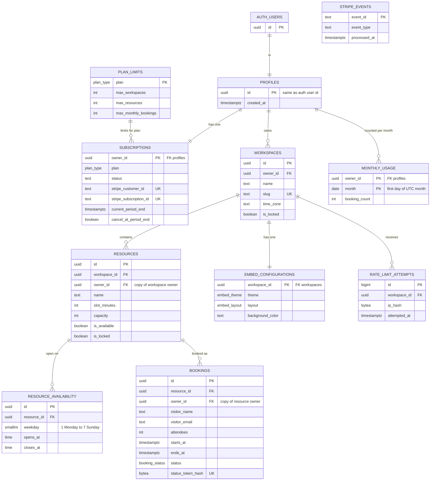

# SlotMate — Database Design

Last updated: 2026-11-14 · Phase 4 (Database design, migrations) and Phase 5 (documentation alignment) · Sources: `docs/MASTER_PROMPT.md`, `docs/PROJECT_REQUIREMENTS.md`, `docs/ARCHITECTURE.md`

**Status:** migrations 1–7 are applied to the development Supabase project (2026-11-14), and 9 of the 21 designed tests (T1–T8 and T19) pass against it (`docs/TESTING.md`). The SQL in `supabase/migrations/` is what is deployed. The SQL snippets in this document are sketches that explain an idea; where a snippet and a migration differ, the migration is right and this document needs fixing. Section 13 lists what is still unverified, and the change history is at the end.

---

## 1. Introduction and glossary

The requirements say *what* SlotMate does, the architecture says *how the parts fit*. This document says *what data exists and which rules the database itself enforces*. The database is the last line of defence (architecture section 3.2): even if our server code has a bug, these rules still hold.

Requirement IDs (`BILL-07`), requirement decisions (`D19`), architecture decisions (`A5`) and database decisions (`DB1`–`DB17`, section 12) refer to the other documents.

| Word | Meaning |
|---|---|
| **Table / row / column** | A table is a spreadsheet-like list. Each row is one item (one booking). Each column is one fact about it (the visitor's name). |
| **Primary key (PK)** | The column(s) that identify a row uniquely. No two rows share a PK and it is never empty. |
| **Foreign key (FK)** | A column that points at a row in another table, for example `resources.workspace_id` points at a workspace. The database refuses a value that points at nothing. |
| **ON DELETE** | What happens to the rows that point at a row when that row is deleted. `CASCADE` = they are deleted too. `RESTRICT` = the delete is refused. |
| **Unique constraint** | A rule that no two rows may have the same value (or the same combination of values). |
| **Check constraint** | A rule about one row, for example "capacity is at least 1". The database refuses a row that breaks it. |
| **Exclusion constraint** | Like a unique constraint, but for *overlaps*: "no two rows may overlap in time for the same resource". |
| **Index** | A sorted lookup structure that makes searches fast, like the index of a book. It costs a little space and slows writes slightly. |
| **Constraint** | Any rule the database enforces by itself (PK, FK, unique, check, exclusion). |
| **Trigger** | A small function the database runs automatically when a row is inserted, changed or deleted. |
| **Function** | Code stored inside the database (written in PL/pgSQL) that our server can call as one step. |
| **Transaction** | A group of steps that either all succeed or all are undone together. |
| **Race condition** | A bug that appears only when two things happen at nearly the same moment and their steps interleave. |
| **Row Level Security (RLS)** | Rules attached to a table that decide, row by row, who may read or change it. With RLS on and no matching rule, nobody gets in. |
| **Policy** | One RLS rule. |
| **Role** | A database identity with permissions. Supabase gives us `anon` (no login, the public key), `authenticated` (a logged-in owner) and `service_role` (our server using the secret key; it skips RLS). |
| **Privilege / GRANT / REVOKE** | The permission to use a table or function at all (before RLS even looks at rows). `REVOKE` removes it. |
| **SECURITY DEFINER** | A function that runs with its creator's powers instead of the caller's, so it can do things the caller may not. Dangerous unless locked down (section 6). |
| **`search_path`** | The list of places Postgres searches when a function mentions a name. If it is not fixed, an attacker could plant a look-alike object. |
| **`timestamptz`** | "Timestamp with time zone": an exact moment in time. Postgres stores it in UTC. |
| **Enum** | A column that may hold only one of a fixed list of words, for example `pending`, `approved`. |
| **Migration** | One SQL file that changes the database. Files run in order and are kept in Git. |

---

## 2. Entity-relationship diagram

An ER diagram shows the tables, their main columns and how they connect. In the lines below, `||--||` means one-to-one, `||--o{` means one-to-many (one on the left, zero or more on the right). `AUTH_USERS` is Supabase Auth's own table; we do not create it.



Two things the picture deliberately shows:

- `MONTHLY_USAGE` hangs off the **owner**, not off bookings or workspaces. Deleting a booking, resource or workspace never touches it (D13 + D19, section 7.3).
- `STRIPE_EVENTS` has no line to anything. It is a standalone memory of which Stripe messages were handled (section 7.6).
- `workspace_members` does not exist (section 8).

---

## 3. Tables

Conventions used by every table:

- Primary keys are `uuid` with `default gen_random_uuid()` (built into Postgres), except where stated. Random IDs cannot be guessed from a web address (ISO-01).
- `created_at` / `updated_at` are `timestamptz not null default now()`. `updated_at` is kept current by the `set_updated_at()` trigger.
- "Required" means `NOT NULL`. "Optional" means the column may be empty (`NULL`).
- Text limits exist so nobody can store megabytes in a name field. The server's `zod` rules (architecture L3) use the same numbers.

### 3.1 `profiles`

**Purpose:** one row per owner account. It anchors ownership (other tables point at it) and gives us one row to lock when we must serialise an owner's changes (section 7.7). Created automatically by a trigger when Supabase Auth creates the account, so server code cannot forget it.

| Column | Type | Required | Default | Note |
|---|---|---|---|---|
| `id` | uuid | required | — | Same value as the Auth user ID. |
| `created_at` | timestamptz | required | `now()` | When the account was made. |

- **PK:** `id`.
- **FK:** `id` → `auth.users(id)` **ON DELETE CASCADE**. If the Auth account is removed, the profile and (through the cascades below) everything the owner had goes too.
- **Unique / check:** none beyond the PK.
- **Indexes:** the PK index only.
- **No email column** (DB2): the email already lives in Supabase Auth; a copy could drift and would be one more private field to protect.

### 3.2 `subscriptions`

**Purpose:** one row per owner holding the plan and the mirrored Stripe state. Every plan limit reads it (BILL-06). Owners can only read it.

| Column | Type | Required | Default | Note |
|---|---|---|---|---|
| `owner_id` | uuid | required | — | Which owner. |
| `plan` | `plan_type` | required | `'free'` | `free` or `pro`. |
| `status` | text | optional | `NULL` | Stripe's own word (`active`, `trialing`, `past_due`, `canceled`…). `NULL` for an owner who never subscribed. Stripe owns this vocabulary, so we add no check list that a new Stripe value could break. |
| `stripe_customer_id` | text | optional | `NULL` | Set at the first checkout. |
| `stripe_subscription_id` | text | optional | `NULL` | Set while a paid subscription exists. |
| `current_period_end` | timestamptz | optional | `NULL` | End of the paid period; shown on the billing page. |
| `cancel_at_period_end` | boolean | required | `false` | True after the owner cancels in the Customer Portal. |
| `created_at`, `updated_at` | timestamptz | required | `now()` | |

- **PK:** `owner_id`.
- **FK:** `owner_id` → `profiles(id)` **ON DELETE CASCADE** (no account, no subscription record). `plan` → `plan_limits(plan)` **ON DELETE RESTRICT** (every plan must have its limits row, and a limits row cannot be deleted while any subscription uses it).
- **Unique:** `stripe_customer_id`, `stripe_subscription_id` — a Stripe object maps to one owner, so a webhook can find the owner without ambiguity. (Unique ignores empty values.)
- **Check:** `plan = 'free' OR stripe_subscription_id IS NOT NULL` — a Pro plan with no Stripe subscription behind it would be a bug.
- **Indexes:** the two unique indexes (they are also the webhook's lookup).

### 3.3 `plan_limits`

**Purpose:** the Free and Pro numbers, stored once in the database so triggers and `submit_booking` can read them (A6). Mirrored in `src/lib/plans.ts` for display (DB6).

| Column | Type | Required | Default | Note |
|---|---|---|---|---|
| `plan` | `plan_type` | required | — | |
| `max_workspaces` | int | required | — | Free 1, Pro 5. |
| `max_resources` | int | required | — | Free 3, Pro 25. |
| `max_monthly_bookings` | int | required | — | Free 100, Pro 1000. |

- **PK:** `plan`. **FK:** none. **Unique:** the PK.
- **Check:** each `max_*` is `> 0`. (`submit_booking` relies on the monthly limit being at least 1, section 7.3.)
- **Indexes:** the PK index. Two rows only.
- Seeded by the migration. No browser role can change it.

### 3.4 `workspaces`

**Purpose:** a place the owner manages; owns the public address and the time zone (WORK-01 to WORK-04, PUB-01).

| Column | Type | Required | Default | Note |
|---|---|---|---|---|
| `id` | uuid | required | random | |
| `owner_id` | uuid | required | — | Who owns it (one owner, D1). |
| `name` | text | required | — | |
| `description` | text | optional | `NULL` | |
| `slug` | text | required | — | The `<workspace-slug>` of `/book/<slug>`. |
| `time_zone` | text | required | **none** (DB10) | A zone name such as `Europe/London`. |
| `is_locked` | boolean | required | `false` | True when hidden and read-only after a downgrade (section 7.8). |
| `created_at`, `updated_at` | timestamptz | required | `now()` | |

- **PK:** `id`.
- **FK:** `owner_id` → `profiles(id)` **ON DELETE CASCADE** (WORK-03: deleting an account removes its workspaces).
- **Unique:** `slug` — two workspaces cannot share an address (PUB-01). `(id, owner_id)` — lets child tables prove their owner copy matches (DB3).
- **Check:** `char_length(btrim(name)) BETWEEN 1 AND 100` (WORK-01 refuses empty names); `description` at most 1000 characters; `slug ~ '^[a-z0-9]+(-[a-z0-9]+)*$'` and `char_length(slug) BETWEEN 3 AND 40` (only lowercase letters, digits and single hyphens, WORK-04).
- **Trigger checks:** `time_zone` must be a real zone name (a trigger asks Postgres, because a check constraint cannot look up the zone list). A BEFORE INSERT trigger enforces the plan's workspace limit (section 7.7).
- **Indexes:** `owner_id` (list "my workspaces", RLS); the unique `slug` index (public page lookup).

### 3.5 `resources`

**Purpose:** a bookable thing inside a workspace (RES-01 to RES-08).

| Column | Type | Required | Default | Note |
|---|---|---|---|---|
| `id` | uuid | required | random | |
| `workspace_id` | uuid | required | — | |
| `owner_id` | uuid | required | — | Copy of the workspace's owner (DB3). |
| `name` | text | required | — | |
| `description` | text | optional | `NULL` | |
| `image_path` | text | optional | `NULL` | Path of the file in Storage (D9), in the form `<owner_id>/<resource_id>/<file name>` (section 5.4). Owners cannot write it; only `set_resource_image()` does. |
| `is_available` | boolean | required | `true` | The owner's on/off switch (RES-06). |
| `is_locked` | boolean | required | `false` | Downgrade lock (section 7.8). |
| `slot_minutes` | int | required | **none** | Fixed slot length (RES-07: the owner must choose one). |
| `capacity` | int | required | **none** | Most people in one booking (RES-08). |
| `created_at`, `updated_at` | timestamptz | required | `now()` | |

- **PK:** `id`.
- **FK:** `(workspace_id, owner_id)` → `workspaces(id, owner_id)` **ON DELETE CASCADE**. Deleting a workspace deletes its resources (D13). Because the pair must match, a resource can never carry a different owner than its workspace.
- **Unique:** `(id, owner_id)` for the bookings table's matching foreign key.
- **Check:** `char_length(btrim(name)) BETWEEN 1 AND 100`; `description` ≤ 1000; `slot_minutes BETWEEN 5 AND 1440` (zero, negative or silly values refused, RES-07); `capacity BETWEEN 1 AND 1000` (RES-08); `image_path` at most 1024 characters (added in migration 3; the other text columns have limits, so this one does too).
- **Trigger checks:** BEFORE INSERT enforces the plan's resource limit (section 7.7).
- **Indexes:** `workspace_id` (list a workspace's resources, public page); `owner_id` (owner-wide counts and RLS).

### 3.6 `resource_availability`

**Purpose:** on which weekdays a resource is open, and the opening and closing clock time. One row per **open** weekday; a missing row means closed that day (AVAIL-01, AVAIL-02).

| Column | Type | Required | Default | Note |
|---|---|---|---|---|
| `id` | uuid | required | random | |
| `resource_id` | uuid | required | — | |
| `weekday` | smallint | required | — | ISO numbering: 1 = Monday … 7 = Sunday (DB9). |
| `opens_at` | time | required | — | Wall-clock time in the workspace's zone. |
| `closes_at` | time | required | — | `24:00` is allowed and means midnight. |

- **PK:** `id`.
- **FK:** `resource_id` → `resources(id)` **ON DELETE CASCADE** (the schedule is meaningless without the resource).
- **Unique:** `(resource_id, weekday)` — one opening window per weekday (DB9). This also serves as the lookup index.
- **Check:** `weekday BETWEEN 1 AND 7`; `closes_at > opens_at` (AVAIL-02).
- **Indexes:** the unique index above.

### 3.7 `bookings`

**Purpose:** booking requests from visitors (PUB-06, BOOK-01 to BOOK-08). Visitor details here are private to the owner (ISO-03).

| Column | Type | Required | Default | Note |
|---|---|---|---|---|
| `id` | uuid | required | random | |
| `resource_id` | uuid | required | — | |
| `owner_id` | uuid | required | — | Copy of the resource's owner (DB3). |
| `visitor_name` | text | required | — | |
| `visitor_email` | text | required | — | |
| `visitor_phone` | text | optional | `NULL` | |
| `note` | text | optional | `NULL` | |
| `attendees` | int | required | — | |
| `starts_at` | timestamptz | required | — | Exact moment the slot starts. |
| `ends_at` | timestamptz | required | — | Exact moment the slot ends; computed by `submit_booking`. |
| `status` | `booking_status` | required | `'pending'` | `pending`, `approved`, `rejected`, `cancelled`. |
| `status_token_hash` | bytea | required | — | SHA-256 hash of the visitor's status code (section 7.5). |
| `created_at`, `updated_at` | timestamptz | required | `now()` | |

- **PK:** `id`.
- **FK:** `(resource_id, owner_id)` → `resources(id, owner_id)` **ON DELETE CASCADE**. Deleting a resource (or its workspace, or the account) deletes its bookings (D13). The monthly count is *not* affected because it is stored elsewhere (D19).
- **Unique:** `status_token_hash` — one booking per status link; also the lookup index for the status page.
- **Check:** `ends_at > starts_at`; `attendees >= 1` (the upper bound is the resource's capacity, which is another table, so `submit_booking` checks it); `char_length(btrim(visitor_name)) BETWEEN 1 AND 100`; `char_length(visitor_email) BETWEEN 3 AND 254` and contains `@`; `visitor_phone` ≤ 30; `note` ≤ 1000; `octet_length(status_token_hash) = 32` (a SHA-256 hash is always 32 bytes).
- **Exclusion constraint (the double-booking rule):**
  `EXCLUDE USING gist (resource_id WITH =, tstzrange(starts_at, ends_at, '[)') WITH &&) WHERE (status IN ('pending','approved'))` — section 7.1.
- **Trigger checks:** BEFORE UPDATE allows only the status changes of section 1.4 of the requirements (section 7.7).
- **Indexes:**
  - The exclusion constraint's own index on `(resource_id, time range)` — it also speeds up "which slots are taken?" for the public page.
  - `(owner_id, created_at DESC, id DESC)` — the owner's booking list, newest first, 20 per page (BOOK-01, PERF-02), and daily charts.
  - `(owner_id, status)` — status filter and dashboard counts (BOOK-07, DASH-04, NOTIF-02 badge).
  - `(resource_id)` — cascade deletes and the "resource usage" chart (ANLT-04).
  - The unique index on `status_token_hash`.
- **Search** (BOOK-08) is a plain `ILIKE` on name, email and the resource's name; no special index (DB13, section 4.3).

### 3.8 `monthly_usage`

**Purpose:** how many booking requests each owner received in each UTC month. It exists because D13 (deletes are permanent) and D19 (deleted requests still count) cannot both be met by counting bookings (A7).

| Column | Type | Required | Default | Note |
|---|---|---|---|---|
| `owner_id` | uuid | required | — | |
| `month` | date | required | — | The **first day** of the UTC month, for example `2026-11-01`. |
| `booking_count` | int | required | `0` | |
| `updated_at` | timestamptz | required | `now()` | |

- **PK:** `(owner_id, month)` — one counter per owner per month; also the lookup index.
- **FK:** `owner_id` → `profiles(id)` **ON DELETE CASCADE**. Deliberately *no* link to bookings, resources or workspaces.
- **Check:** `booking_count >= 0`; `extract(day from month) = 1` (it must be a first-of-month date; written this way because `date_trunc` on a date goes through `timestamptz` and would depend on the session time zone).
- **Indexes:** the PK index.
- No row for a month means a count of 0, so nothing has to run on the 1st (section 7.3).

### 3.9 `rate_limit_attempts`

**Purpose:** short-lived records used to limit the public form to 5 requests per 10 minutes per visitor per workspace (SEC-06, D24, A9).

| Column | Type | Required | Default | Note |
|---|---|---|---|---|
| `id` | bigint | required | identity | Auto-numbered. |
| `workspace_id` | uuid | required | — | Which workspace the attempt was for. |
| `ip_hash` | bytea | required | — | Keyed hash of the visitor's IP made in Node (DB11). The IP itself is never stored. |
| `attempted_at` | timestamptz | required | `now()` | |

- **PK:** `id`.
- **FK:** `workspace_id` → `workspaces(id)` **ON DELETE CASCADE** (a deleted workspace needs no records).
- **Check:** `octet_length(ip_hash) = 32`.
- **Indexes:** `(workspace_id, ip_hash, attempted_at)` — the "how many recent attempts?" count; `(attempted_at)` — the old-record clean-up.
- **No browser role can touch this table** (section 6).

### 3.10 `stripe_events`

**Purpose:** remembers which Stripe webhook messages were handled so a repeat does nothing (BILL-05, A14).

| Column | Type | Required | Default | Note |
|---|---|---|---|---|
| `event_id` | text | required | — | Stripe's ID, such as `evt_123…`. |
| `event_type` | text | required | — | Such as `customer.subscription.updated`. |
| `received_at` | timestamptz | required | `now()` | |
| `processed_at` | timestamptz | optional | `NULL` | Empty until the handler finishes (section 7.6). |

- **PK:** `event_id` (a second insert of the same ID is refused — that is the whole point).
- **FK:** none. **Check:** none. **Indexes:** the PK index; `received_at` for the 30-day clean-up (DB12).
- **No browser role can touch this table.**

### 3.11 `embed_configurations`

**Purpose:** the widget's saved options for a workspace (EMBED-03 to EMBED-05, A13).

| Column | Type | Required | Default | Note |
|---|---|---|---|---|
| `workspace_id` | uuid | required | — | |
| `theme` | `embed_theme` | required | `'light'` | `light` or `dark`. |
| `layout` | `embed_layout` | required | `'list'` | `list` or `grid` (D26). |
| `background_color` | text | optional | `NULL` | `NULL` = the theme's default. |
| `updated_at` | timestamptz | required | `now()` | |

- **PK / FK:** `workspace_id` → `workspaces(id)` **ON DELETE CASCADE** — exactly one row per workspace, removed with it (WORK-03).
- **Check:** `background_color ~ '^#[0-9a-fA-F]{6}$'` — only a plain hex colour code, never anything that could carry script (SEC-02).
- **Trigger checks:** a default row is created automatically with each new workspace. A Free owner cannot *change to* a Pro-only value (`grid`, or a background colour); leftover Pro values after a downgrade are kept but ignored when the widget is built (section 7.7).
- **Indexes:** the PK index.

---

## 4. Enums, functions and triggers

### 4.1 Enums (DB14)

| Enum | Values |
|---|---|
| `plan_type` | `free`, `pro` |
| `booking_status` | `pending`, `approved`, `rejected`, `cancelled` |
| `embed_theme` | `light`, `dark` |
| `embed_layout` | `list`, `grid` |

Enums make the generated TypeScript types exact unions. Adding a value later is easy; removing one is not, which is acceptable for these stable lists.

### 4.2 Extensions

**Exactly one extension is needed: `btree_gist`** (for the exclusion constraint, so a `uuid` equality and a time-range overlap can share one index). It ships with Postgres and is available on Supabase cloud. `gen_random_uuid()`, range types, time zones, `ILIKE` and `sha256` are built in. **Not used:** `pg_trgm`, `pgcrypto`, `unaccent`, `pgTAP`, `pg_cron` (DB13).

### 4.3 Search (DB13 — confirmed)

Booking search uses plain `ILIKE '%text%'` on visitor name, visitor email and resource name, always filtered by `owner_id` first. A per-owner list is small (at most 1,000 requests a month on Pro), so a sequential scan within one owner's rows is fast enough. If the optional 1,000-booking test (PERF-02) misses the 3-second target, adding `pg_trgm` becomes a **new** decision. Nothing extra is installed now.

### 4.4 Functions and triggers

All are created in the `public` schema, and all follow the rules in section 6.

| Name | Kind | What it does |
|---|---|---|
| `set_updated_at()` | trigger | Sets `updated_at = now()` on update. |
| `handle_new_user()` | trigger on `auth.users` (after insert) | Creates the owner's `profiles` row and a Free `subscriptions` row. |
| `handle_new_workspace()` | trigger (after insert on `workspaces`) | Creates the default `embed_configurations` row. |
| `validate_time_zone()` | trigger (before insert/update of `workspaces.time_zone`) | Refuses names that are not real time zones. |
| `current_plan(owner)` | helper | Returns `pro` only if `plan = 'pro'` and `status` is `active` or `trialing` (DB7), otherwise `free`. |
| `enforce_workspace_limit()` / `enforce_resource_limit()` | trigger (before insert) | Locks the owner's profile row, counts, compares with `plan_limits`, refuses over the limit. |
| `enforce_booking_transition()` | trigger (before update of `status`) | Allows only the three permitted status changes, for every role. |
| `enforce_embed_plan_rules()` | trigger (before insert/update on `embed_configurations`) | Blocks a Free owner from changing to Pro-only values. |
| `reconcile_locks(owner)` | function, also fired by a trigger on `subscriptions` and after deletes | Applies or lifts the downgrade lock (section 7.8). |
| `apply_downgrade_selection(owner, workspace, resources)` | function | Applies the owner's validated selection atomically; callable only by `service_role` (section 7.8). |
| `submit_booking(...)` | function | The whole booking submission (section 7.2). |
| `check_rate_limit(workspace, ip_hash)` | function | Records an attempt, counts recent ones, answers allowed / not allowed (section 7.4). |
| `claim_stripe_event(id, type)` / `mark_stripe_event_processed(id)` | functions | Webhook memory (section 7.6). |
| `set_resource_image(owner, resource, path)` | function | Records a resource's image path after the server-side upload; refuses locked or foreign resources and paths outside the owner's folder (section 5.4, owner decisions Q2 and R4). |

### 4.5 Functions as built

The 18 functions that exist in `public` after migrations 1–7. "Runs as" is the security setting: `DEFINER` runs with the creating role's powers, `INVOKER` with the caller's. Every function has `SET search_path = ''` and no `EXECUTE` for `PUBLIC`, `anon` or `authenticated`. The "Who calls it" column shows who may call the function directly; trigger functions are only ever fired by their trigger.

| Function | Kind | Runs as | Who calls it | Migration |
|---|---|---|---|---|
| `set_updated_at()` | trigger | INVOKER | trigger only | 1 |
| `current_plan(p_owner_id)` | helper | INVOKER | `service_role` | 2 |
| `handle_new_user()` | trigger on `auth.users` | DEFINER | trigger only | 2 |
| `handle_new_workspace()` | trigger | DEFINER | trigger only | 3 |
| `validate_time_zone()` | trigger | INVOKER | trigger only | 3 |
| `enforce_embed_plan_rules()` | trigger | DEFINER | trigger only | 3 |
| `enforce_booking_transition()` | trigger | INVOKER | trigger only | 4 |
| `enforce_workspace_limit()`, `enforce_resource_limit()` | trigger | DEFINER | trigger only | 6 |
| `submit_booking(...)` | function | DEFINER | `service_role` | 6 |
| `check_rate_limit(p_workspace_id, p_ip_hash)` | function, returns boolean | DEFINER | `service_role` | 6 |
| `claim_stripe_event(p_event_id, p_event_type)` | function, returns `claimed` or `duplicate` | DEFINER | `service_role` | 6 |
| `mark_stripe_event_processed(p_event_id)` | function | DEFINER | `service_role` | 6 |
| `reconcile_locks(p_owner_id)` | function | DEFINER | `service_role` | 6 |
| `reconcile_locks_on_subscription_change()`, `reconcile_locks_after_delete()` | triggers (the second is statement-level) | DEFINER | trigger only | 6 |
| `apply_downgrade_selection(p_owner_id, p_workspace_id, p_resource_ids)` | function | DEFINER | `service_role` | 6 |
| `set_resource_image(p_owner_id, p_resource_id, p_path)` | function | DEFINER | `service_role` | 6 |

`current_plan` is `INVOKER` because it is not on the approved `DEFINER` list; it reads `subscriptions`, so a direct caller needs `SELECT` there (`service_role` has it). The `DEFINER` functions that call it run it as the table owner.

**Errors the triggers raise** (short, fixed names, like the booking errors of section 7.2; the server maps each to a message):

- Plan-limit triggers: `not_owner`, `owner_not_found`, `workspace_limit_reached`, `resource_limit_reached` (section 7.7).
- `enforce_booking_transition`: `invalid_status_change` (section 7.7).
- `validate_time_zone`: `invalid_time_zone` (section 7.9).
- `enforce_embed_plan_rules`: `pro_only_embed_option` (section 7.7).

---

## 5. Row Level Security

### 5.1 The rules

1. **RLS is enabled on every table in `public`**: `profiles`, `subscriptions`, `plan_limits`, `workspaces`, `resources`, `resource_availability`, `bookings`, `monthly_usage`, `rate_limit_attempts`, `stripe_events`, `embed_configurations`. A migration check (section 10) fails if any table has RLS off.
2. **Visitors have no database permissions at all** (A4). The public pages, the widget, the status page and the booking submission are served by our server code using the secret key (`service_role`), which skips RLS and returns only the fields ISO-02 allows. The public key (`anon`) is useless on its own. The server-only secret key is used in exactly six approved areas: public reads, booking submission, the rate limit, the Stripe webhook, resource image uploads (S1), and saving the owner's downgrade selection (S2, section 7.8).
3. **Two layers.** First *privileges* (can this role touch the table or column at all?), then *RLS* (which rows?). Supabase tends to hand new tables broad default privileges, so our migration states them explicitly: `REVOKE ALL` on every table and sequence from `anon` and `authenticated`, change the default privileges so future objects start closed, then `GRANT` back only what is listed below.
4. **Policies are written for the `authenticated` role** and compare against `(select auth.uid())` — the logged-in owner's ID. Wrapping it in `select` lets Postgres evaluate it once per query instead of once per row.
5. **Column-level grants** restrict what an owner can change. For example an owner may update a booking's `status` but no other booking column, and may never write `is_locked`, `owner_id`, `plan` or any usage count.

### 5.2 Who can do what

"Owner" = a logged-in owner using their own login (RLS applies). "Visitor via server" = a visitor, served by our server code with the secret key. "Anonymous" = anyone calling Supabase directly with only the public key.

| Table | Owner (own rows only) | Visitor via server code | Anonymous (public key only) |
|---|---|---|---|
| `profiles` | Read own row. | Nothing. | Nothing. |
| `subscriptions` | **Read** own row. No insert, update or delete. | Nothing. (The Stripe webhook, not a visitor, writes it.) | Nothing. |
| `plan_limits` | Read (two rows of plain numbers, nothing private). | Nothing. | Nothing. |
| `workspaces` | Read, create (within plan limit), edit name/description/slug/time zone **unless locked**, delete (even if locked). Cannot write `is_locked`. `owner_id` can be sent on insert only (the policy forces it to the logged-in owner) and never on update (owner decision Q6). | Read name, description, slug, time zone of an existing, unlocked workspace. | Nothing. |
| `resources` | Read, create (within limit, not into a locked workspace), edit **unless locked**, delete. Cannot write `is_locked` or `image_path`. `owner_id` and `workspace_id` can be sent on insert only (the policy and the composite foreign key force them to match the owner's own workspace) and never on update (Q6). | Read name, description, image, capacity, slot length of resources that are available and unlocked. | Nothing. |
| `resource_availability` | Read; create, edit, delete for own resources **unless locked**. | Read the schedule of an available, unlocked resource (to compute slots). | Nothing. |
| `bookings` | Read own. Change **only** `status`, and only along the allowed path, **unless locked**. Delete own (**unless locked**). **Cannot insert.** | Create **only** through `submit_booking`. Read taken time ranges with no personal details (ISO-03). Read one booking's resource, time, name and status by status-token hash. Cannot edit or delete. | Nothing. |
| `monthly_usage` | Read own counts. Cannot write. | Counter raised only inside `submit_booking`; "limit reached" can be read. | Nothing. |
| `rate_limit_attempts` | **No access.** | Only through `check_rate_limit`. | **No access.** |
| `stripe_events` | **No access.** | Not involved. The webhook handler (secret key) uses the two functions. | **No access.** |
| `embed_configurations` | Read own; edit theme/layout/background of own workspace **unless locked** (Pro-only values only if Pro). No insert or delete (the row is automatic). | Read the options of an existing, unlocked workspace to build the widget. | Nothing. |

"Locked" means the downgrade state of section 7.8. For a resource, an availability row, a booking or the embed options, "locked" means the row itself **or its workspace** is locked.

How "Visitor via server" works as built (owner decisions Q3 and Q11): there are no public read functions in version 1. Our server code uses `service_role` and reads the tables directly, and `service_role` holds only the table privileges it needs (section 6.3). On `bookings` its `SELECT` is limited to the columns `id`, `resource_id`, `owner_id`, `visitor_name`, `starts_at`, `ends_at`, `status` and `status_token_hash`; it cannot read `visitor_email`, `visitor_phone` or `note` at all, so a query that asks for every column (`select *`) fails with "permission denied". Server code must name its columns. The server's own code decides which of these fields a visitor page may show (ISO-02, ISO-03).

### 5.3 Policy sketch (explanatory; the real policies are in migration 7)

```sql
-- workspaces: an owner sees only their own rows
create policy "owner reads own workspaces" on public.workspaces
  for select to authenticated
  using (owner_id = (select auth.uid()));

-- workspaces: edit own rows, but not while locked
create policy "owner updates own unlocked workspaces" on public.workspaces
  for update to authenticated
  using (owner_id = (select auth.uid()) and not is_locked)
  with check (owner_id = (select auth.uid()) and not is_locked);
```

The `USING` part says which existing rows the policy applies to. The `WITH CHECK` part says what the row must look like after the change.

### 5.4 Storage (resource images)

Images live in a publicly readable Storage bucket `resource-images`. The bucket allows JPG, PNG and WebP files up to 2 MB (D9, RES-05). Uploads go through server-side application code only: the server validates the actual file type and size, verifies the owner and resource, then writes using the service-role key. The key is server-only and is never exposed to browser code. No browser role has a Storage write policy. Image uploads are the fifth of the six approved service-role usage areas; the sixth is saving the downgrade selection (A4; section 5.1).

**As built (migrations 3, 6 and 7; owner decisions Q2 and R4):**

- **The bucket** is created by migration 7 as a public bucket with a 2 MiB (2,097,152 bytes) limit and the types `image/jpeg`, `image/png` and `image/webp`. The insert is an upsert, so it also works if the bucket already exists. No policy at all exists on `storage.objects`: public files are served through the bucket's public address, and nobody can list the bucket or write to it with a browser key (inferred from the absence of policies; T21 will test it).
- **The path** stored in `resources.image_path` has the form `<owner_id>/<resource_id>/<file name>`, where both IDs are the lowercase, hyphenated UUID text. The server generates the file name itself (for example a random name plus the extension of the validated file type) and never reuses the visitor's or owner's original file name. The column allows at most 1024 characters.
- **Recording the path** goes only through `set_resource_image(p_owner_id, p_resource_id, p_path)`, a `SECURITY DEFINER` function callable by `service_role` only. `service_role` has **no** `UPDATE` privilege on `resources`. The function refuses unless the resource belongs to `p_owner_id` **and** neither the resource nor its workspace is locked (a locked resource is read-only even for our server, which skips RLS). It also refuses a path that does not start with `<p_owner_id>/<p_resource_id>/`, a path with nothing after that prefix, and a path containing `..`. A `NULL` path removes the image. Errors: `resource_not_found`, `resource_locked`, `invalid_path`.
- **The path rule is a safety net, not a file-name validator.** It does not restrict the characters in the file name (percent-encoded dots, spaces, extensions). The server flow must generate safe names (open item in `docs/DEVELOPMENT_LOG.md`).
- **Order of work is not decided yet (Phase 9).** Calling `set_resource_image` first makes a locked or foreign resource fail before any file is stored, but a failed Storage write would then leave a path with no file; writing the file first has the opposite problem. Phase 9 chooses, and must handle the failure case. Deleting a workspace or resource still needs the Server Action to delete the files first (DB15).

---

## 6. Function and table access

This section is a hard rule for the migrations. It exists because Supabase, by default, lets `anon` and `authenticated` call any function in `public` through its web API, and Postgres lets everyone (`PUBLIC`) execute any new function. A powerful `SECURITY DEFINER` function left in that state would let a stranger with the public key call it.

### 6.1 Rules for every function

1. `submit_booking` and **every other server-only function**, including the protected downgrade-selection function and `set_resource_image`, must, in the migration that creates it, **explicitly revoke `EXECUTE` from `PUBLIC`, `anon` and `authenticated`**, and then grant `EXECUTE` to `service_role` only.
   ```sql
   revoke execute on function public.submit_booking(/* arguments */) from public, anon, authenticated;
   grant  execute on function public.submit_booking(/* arguments */) to service_role;
   ```
2. Every function sets a **fixed `search_path`**: `SET search_path = ''`, and refers to every object with its schema name (`public.bookings`, `pg_catalog.now()`). No function relies on the caller's `search_path`.
3. `SECURITY DEFINER` is used only where the function must do what the caller may not. The approved list (owner decisions Q1 and Q2) is: `submit_booking`, `check_rate_limit`, `claim_stripe_event`, `mark_stripe_event_processed`, `apply_downgrade_selection`, `set_resource_image`, `reconcile_locks`, `enforce_workspace_limit`, `enforce_resource_limit`, `handle_new_user`, `handle_new_workspace`, `enforce_embed_plan_rules`, `reconcile_locks_on_subscription_change` and `reconcile_locks_after_delete`. Each of them must do something its caller is not allowed to do: write a table the caller has no privilege on, take a row lock the caller may not take, call a function the caller may not execute, or use a table no role can touch. Each such function validates its own inputs and returns or changes only what it must. A function not on this list is `SECURITY INVOKER`; adding to the list is a new decision.
4. The migration also changes the **default privileges** so a function added later starts with no access for `PUBLIC`, `anon` and `authenticated`. Forgetting step 1 then fails closed (nobody can call it) instead of open.
5. Trigger functions are not callable through the web API as normal functions, but get the same revoke and `search_path` treatment, for the same fail-closed reason.
6. A test (section 10) lists every function in `public` and fails if any is executable by `anon` or `authenticated` without being on an explicit allow-list in this document. The allow-list is currently **empty**. (Test T6 implements this check.)
7. No RLS policy calls a function in `public`. The policies use only `auth.uid()`, which Supabase already lets `authenticated` run. So `authenticated` needs no `EXECUTE` on any of our functions. If a policy ever needs one, the migration must grant `EXECUTE` to `authenticated` for that function (the global revoke of rule 4 removes the default) **and** add it to the allow-list of rule 6 as a documented decision.
8. `service_role` also starts closed: it does not get `TRUNCATE`, `TRIGGER` or `REFERENCES` on any table, existing or future (migration 7 revokes them from existing tables and from the default privileges for future ones). Only `MAINTAIN` remains.

### 6.2 Who may call what

| Function | `anon` | `authenticated` (owner) | `service_role` (our server) |
|---|---|---|---|
| `submit_booking` | no | no | yes |
| `check_rate_limit` | no | no | yes |
| `claim_stripe_event`, `mark_stripe_event_processed` | no | no | yes |
| `reconcile_locks` | no | no | yes (also run by triggers) |
| `apply_downgrade_selection` | no | no | yes |
| `current_plan` | no | no | yes |
| `set_resource_image` | no | no | yes |
| All trigger functions | no | no | no direct calls needed |

### 6.3 Tables never reachable by browser roles

| Table | `anon` | `authenticated` | Who can use it |
|---|---|---|---|
| `rate_limit_attempts` | no privileges | no privileges | `check_rate_limit` only |
| `stripe_events` | no privileges | no privileges | the two Stripe-event functions only |

And these are reachable by a logged-in owner only as **read-only** (own rows): `profiles`, `subscriptions`, `monthly_usage`, `plan_limits`. For `anon`, **every** table is closed. `auth.users` is managed by Supabase and is never exposed to our own queries.

Only the `public` schema is exposed through Supabase's web API; nothing else we create is.

### 6.4 What `service_role` holds (migration 7)

Because migration 1 closed the default privileges, nothing is granted by accident; migration 7 grants exactly this (verified read-only on 2026-11-14; summary in `docs/DEVELOPMENT_LOG.md` Phase 4f, raw output kept in the private notes folder):

- `SELECT` on `workspaces`, `resources`, `resource_availability`, `embed_configurations`, `monthly_usage`, `plan_limits` and `subscriptions`.
- Column-limited `SELECT` on `bookings` (section 5.2) and column-limited `UPDATE` on `subscriptions` (`plan`, `status`, `stripe_customer_id`, `stripe_subscription_id`, `current_period_end`, `cancel_at_period_end`) for the Stripe webhook.
- **No** privilege on `profiles`, `rate_limit_attempts` or `stripe_events`, and **no** `INSERT`, `UPDATE` or `DELETE` anywhere else. Everything else it does goes through the `EXECUTE`-limited functions of section 4.5.
- `MAINTAIN` (vacuum and analyze) remains from Supabase's defaults. On PostgreSQL 17 it also allows `LOCK TABLE`, but only through a raw SQL connection, which the project does not use.

---

## 7. Special designs

### 7.1 Double-booking prevention (AVAIL-04, PERF-03)

**The race condition.** Imagine a function that does two steps: (1) "is this slot free?" and (2) "save the booking". Two visitors, Ana and Ben, both press Submit for the same slot at the same moment:

```
Ana: step 1  asks "is 10:00 free?"  -> yes
Ben: step 1  asks "is 10:00 free?"  -> yes     (Ana has not saved yet)
Ana: step 2  saves her booking
Ben: step 2  saves his booking                 -> two bookings for 10:00
```

Each check was correct when it ran; the bug is the gap between checking and saving. Checking in server code, or inside a function, cannot close that gap on its own.

**The fix: a rule the database applies at the moment of saving.**

```sql
-- sketch, not run
alter table public.bookings
  add constraint bookings_no_overlap
  exclude using gist (
    resource_id WITH =,
    tstzrange(starts_at, ends_at, '[)') WITH &&
  ) where (status in ('pending', 'approved'));
```

Plain reading: *"for the same resource, no two pending-or-approved bookings may have time ranges that overlap."*

- Postgres checks this while inserting, using an index. If Ana's row is saved but not yet committed, Ben's insert **waits** for her. When she commits, Ben's insert fails with error `23P01` (exclusion violation); if she rolls back, Ben's succeeds. Exactly one wins, always (PERF-03).
- `'[)'` means the range includes its start and excludes its end, so a booking 10:00–11:00 and another 11:00–12:00 do **not** overlap.
- The `WHERE` makes rejected and cancelled bookings invisible to the rule, so their slot is free again (D10, BOOK-04, BOOK-05). A deleted booking is gone entirely.
- It is an *overlap* rule, not "same start time". If an owner later changes a resource's slot length, old and new bookings still cannot overlap.
- Statuses only move forward (section 7.7), so a rejected or cancelled booking can never be re-activated and cause a late conflict. Approving a pending booking changes nothing for the rule: both statuses already hold the slot.
- The slot-checking inside `submit_booking` stays: it gives friendly messages and rejects invalid slots. The constraint is the guarantee (DB4).

### 7.2 The booking submission function (A5, DB5)

`public.submit_booking(...)` is called by the Server Action after the rate limit and `zod` validation. The server passes only what the visitor chose; the database computes everything else.

**Inputs:** resource ID, `starts_at` (timestamptz), visitor name, email, optional phone, optional note, attendees, and the `status_token_hash` (the server made the random code and hashed it, section 7.5).
**Properties:** `SECURITY DEFINER`, `SET search_path = ''`, `EXECUTE` for `service_role` only (section 6). The whole call is one transaction.

Steps, in order:

1. **Load** the resource, its workspace (slug, time zone, locked flag) and the owner's ID, in one query. No row → error `not_bookable`.
2. **Bookable?** The resource must have `is_available = true`, and neither the resource nor its workspace may be locked (RES-06, BILL-09). Otherwise → `not_bookable`.
3. **Convert to the workspace's clock.** Compute the local start: `starts_at AT TIME ZONE time_zone`. When clocks go back and an hour happens twice, only the **first** copy of that hour is bookable; the **second** copy → `invalid_slot` (ARCHITECTURE 5.4). A local time inside the skipped hour of a clocks-forward day can never come from a real instant, so it is never offered. The exact method is in section 7.2.1.
4. **Valid slot?** Find the `resource_availability` row for that local date's ISO weekday. No row → `invalid_slot`. Then require the local time ≥ `opens_at`, the local time + `slot_minutes` ≤ `closes_at`, and the distance from `opens_at` to be an exact multiple of `slot_minutes` (AVAIL-01 to AVAIL-03, AVAIL-05).
5. **Compute `ends_at`** as the local start plus `slot_minutes`, converted back to an exact moment (if that local end falls in a repeated hour, the **first** copy is used; section 7.2.1). `ends_at` must be after `starts_at`, otherwise → `invalid_slot`. The visitor cannot send their own end time.
6. **Not in the past, not too far ahead:** `starts_at > now()` and the local date ≤ today (in the workspace's zone) + 90 days → otherwise `past` or `too_far` (D8). "Now" is the database server's clock.
7. **Attendees:** between 1 and the resource's `capacity` → otherwise `too_many_attendees` (RES-08, PUB-04).
8. **Monthly limit and count, atomically.** Look up the owner's plan limit (`current_plan` + `plan_limits`) and run one statement:
   `INSERT INTO monthly_usage (owner_id, month, booking_count) VALUES (owner, first-of-UTC-month, 1) ON CONFLICT (owner_id, month) DO UPDATE SET booking_count = monthly_usage.booking_count + 1 WHERE monthly_usage.booking_count < <limit> RETURNING booking_count`.
   No row returned → the limit is reached → error `limit_reached` (BILL-07, PUB-06). See section 7.3.
9. **Insert** the booking with status `pending` and the token hash (PUB-06).
10. **Overlap?** If the insert hits the exclusion constraint (`23P01`), the function raises `slot_taken`. Raising an error undoes the *whole* call, **including the +1 from step 8**, so a refused request never uses up allowance (ARCHITECTURE 4.2).
11. **Return** the new booking's ID, `starts_at` and `ends_at`. The Server Action redirects to `/booking/<code>`.

Errors are raised as `RAISE EXCEPTION` with a short fixed message (`slot_taken`, `limit_reached`, `not_bookable`, `invalid_slot`, `past`, `too_far`, `too_many_attendees`). The Server Action maps each to its friendly message (AVAIL-05).

The usage row is locked from step 8 until the transaction ends, which is a few milliseconds; submissions of the same owner queue briefly and submissions of different owners never interfere.

**As built (migration 6):**

- The arguments are `p_resource_id`, `p_starts_at`, `p_visitor_name`, `p_visitor_email`, `p_visitor_phone`, `p_note`, `p_attendees` and `p_status_token_hash`. The phone and note are passed as `NULL` when empty. The result is one row with `booking_id`, `booking_starts_at` and `booking_ends_at` (the column names differ from the table's so they cannot clash with it inside the function).
- Step 1 takes shared row locks (`FOR SHARE`) on the resource and its workspace, so an owner's edit or a lock change waits until the booking commits. Shared locks do not block other bookings.
- Step 4 does its arithmetic in seconds since midnight, because `time + interval` wraps around midnight and `closes_at` may be `24:00`.
- Errors that are not one of the seven fixed messages can still come out as raw database errors (a check violation such as a name that is too long, `23514`; a duplicate token hash, `23505`; a deadlock, `40P01`). The Server Action's `zod` validation runs first and the action needs a generic fallback message. Any of them undoes the whole call, including the +1.

#### 7.2.1 Clock changes (owner decisions Q7 and R1)

The rules, in terms of what the function does:

- **Start.** `starts_at` is an exact moment, so its local time always exists. The function compares the UTC offset of the moment with the offset 24 hours earlier. If the offset dropped (clocks went back) and the moment minus that drop has the same wall-clock time, then `starts_at` is the **second** copy of a repeated hour and is refused. The first copy, the moments after the repeated hour, and every time on a clocks-forward day are accepted. A plain "convert to local and back" check would be wrong: PostgreSQL resolves an ambiguous local time to the **later** copy, so that check would refuse the first copy and accept the second.
- **End.** The local end is the local start plus `slot_minutes`. It is converted back to a moment; if that local time is ambiguous (inside a repeated hour) the **first** copy is used, by the same offset comparison. Without this, a slot ending inside the repeated hour got an end one hour too late and overlapped the next slot (found in re-review 2). A safety net refuses the booking if `ends_at` would not be after `starts_at`.
- **Slots that cross a clock change are allowed.** The slot keeps its wall-clock end, so its real length can differ from `slot_minutes` by the size of the shift (for example 120 real minutes for a 60-minute slot that starts in the first copy of the repeated hour).
- **Known limitation (open item).** On a clocks-forward day, slot lengths under 60 minutes that do not divide 60 (45, 25, 40, 50 and so on) can produce two grid slots that overlap in real time, because the local-to-real mapping is not increasing across the skipped hour. The overlap rule refuses whichever is booked second with `slot_taken`, so there is no double booking, but a slot that looks free is refused on two days a year. Lengths of 30, 60 and 90 minutes (and any length that divides 60 or is 60 or more) are not affected. Options for later: restrict `slot_minutes`, or clamp a nonexistent end to the moment of the change.
- **Not yet tested against a live database** (T10 is planned). The behaviour was checked by hand-tracing the dates of 2026 for London, Berlin, New York and Sydney in re-review 3 (`docs/DEVELOPMENT_LOG.md`). `src/lib/time` (Phase 10) must use the same two rules, and T10 must include both copies of the repeated hour, slots that end in it, and the skipped hour.

### 7.3 The monthly usage counter (A7, D19)

- **One row per owner per UTC month** in `monthly_usage` (section 3.8). The month key is `date_trunc('month', now() AT TIME ZONE 'UTC')::date`.
- **Raised only in `submit_booking`**, in the same transaction as the booking insert. Nothing lowers it, so deleting a booking, resource, or workspace changes nothing (D13 + D19, BOOK-06).
- **Why one statement is race-proof.** The `INSERT … ON CONFLICT DO UPDATE … WHERE count < limit` locks the row, and a second request waits for the first, then re-checks the `WHERE` with the new value. If one place is left, exactly one of two simultaneous requests gets it.
- **No reset job.** A new month simply has no row; the first request creates it with 1. "No row" reads as 0.
- **Limit source:** the owner's plan *at that moment* (`current_plan`), so an upgrade mid-month raises the limit immediately (ARCHITECTURE 6.1). `plan_limits.max_monthly_bookings` is checked to be at least 1, which the first-insert path relies on.
- **Readers:** the billing page and the public "not accepting requests" message read the row through server code.

### 7.4 Rate-limit records with a hashed IP per workspace (A9, D24, SEC-06)

- **Stored:** `workspace_id`, `ip_hash`, `attempted_at` (section 3.9). The Node server computes `ip_hash = HMAC-SHA256(RATE_LIMIT_SECRET, ip)` (DB11). The database never sees the IP or the secret; without the secret nobody can reverse the hashes to addresses. Nothing links a record to a booking, name or email.
- **`check_rate_limit(workspace_id, ip_hash)`** does, in one call: (1) delete records older than 10 minutes; (2) insert this attempt; (3) count this `ip_hash` + this `workspace_id` in the last 10 minutes; (4) return *allowed* if the count is 5 or fewer, *refused* otherwise.
- **Every attempt is recorded, including refused ones** (A9b), so a flood keeps being refused.
- **Per visitor per workspace:** the count filters on both columns, so attempts at workspace X never reduce the allowance for workspace Y (A9c).
- **Never counts against the owner's monthly limit:** this function runs before `submit_booking` and touches `monthly_usage` not at all (SEC-06).
- **Clean-up is built in:** step 1 above; no scheduled job (A9d).
- **Two simultaneous attempts** may each see the other's record and both be refused at exactly the boundary. That errs on the safe side and is accepted.
- **Access:** table closed to all browser roles; function callable by `service_role` only (section 6).

### 7.5 The status token hash (A8, NOTIF-03)

- The Server Action creates a random 256-bit code with the secure random generator, computes its SHA-256 hash (32 bytes) in Node, and passes **only the hash** to `submit_booking`. The code itself is never stored anywhere in the database.
- `bookings.status_token_hash` is `bytea`, `NOT NULL`, `UNIQUE`, with a length-32 check.
- To open `/booking/<code>`, the server hashes the code from the address and looks for a booking with that hash through server code. No match → "not found". The page returns only resource, date, time, the visitor's name and the status — never email, phone or note (ISO-03).
- Because the code is long and random, an unsalted fast hash is sufficient: there is nothing to guess. A leaked database would not reveal working links.
- Deleting the booking removes the row and the hash, so the link then says "not found" (NOTIF-03).

### 7.6 Remembered Stripe webhook IDs (A14, BILL-05, DB12)

1. After checking the Stripe signature, the handler calls `claim_stripe_event(event_id, type)`.
2. The function tries `INSERT … ON CONFLICT DO NOTHING`:
   - Inserted → returns **`claimed`**: process it.
   - Already there with `processed_at` set → returns **`duplicate`**: do nothing, reply 200.
   - Already there but `processed_at` empty (an earlier try crashed halfway) → returns **`claimed`** so Stripe's retry can finish the job.
3. The handler asks Stripe for the subscription's *current* state, saves it to `subscriptions`, then calls `mark_stripe_event_processed(event_id)`.
4. Because the saved data always comes from Stripe's current answer, handling a message twice, or two copies at once, ends in the same state. Out-of-order messages cannot leave stale data either.
5. During later webhooks, rows older than 30 days are deleted. There is no scheduled job.

### 7.7 Plan limits, allowed status changes and the read-only subscription (A6)

**Plan limits (BILL-07).** A `BEFORE INSERT` trigger on `workspaces` and on `resources`:

1. `SELECT … FROM profiles WHERE id = NEW.owner_id FOR UPDATE` — locks the owner's profile row, so two create requests from the same owner run one after the other. (Without this lock, two parallel creates could each count "2 of 3" and both succeed, ending at 4 of 3.)
2. Counts the owner's existing workspaces (or resources), **including locked ones**.
3. Compares with `plan_limits` for `current_plan(owner)`; at or over the limit → raise a clear error that the server turns into the "upgrade" message.

This holds even for a request that skips our web pages, because it lives in the table, not in server code. The server still checks first to show a friendly message; the trigger is the guarantee.

**As built (migration 6).** Before the lock, a logged-in owner who sends **another owner's** `owner_id` is refused with `not_owner`: the trigger runs before row level security, and without this check it could be used to probe whether another account exists or is at its limit. (`auth.uid()` is empty for `service_role` and for migrations, so those paths are not affected.) A missing profile gives `owner_not_found`; being at or over the limit gives `workspace_limit_reached` or `resource_limit_reached`. The server maps these names to messages, like the booking errors of section 7.2. `lib/plans.ts` holds the same numbers for display, and a test must verify it matches `plan_limits` (DB6, section 10).

**Allowed status changes.** A `BEFORE UPDATE OF status` trigger on `bookings` allows only `pending → approved`, `pending → rejected`, `approved → cancelled`; everything else raises an error (BOOK-03 to BOOK-05). It applies to **every** role, including our own server. Combined with **column-level privileges** (owners may update only the `status` column), an owner cannot alter a visitor's name, the booking time, or move a booking to another resource, even by calling the database directly.

**Read-only subscription (BILL-06).** For `subscriptions`:

- `authenticated` has `SELECT` and nothing else; there is no insert, update or delete privilege and no such policy.
- The select policy shows only `owner_id = (select auth.uid())`.
- `anon` has nothing.
- The row is created by `handle_new_user()` and changed only by the Stripe webhook running as `service_role`.
- `plan` changes only from a verified webhook (A14). `current_plan()` ignores `current_period_end`: if a webhook is late, the owner stays Pro until Stripe says otherwise.

**Pro-only widget values.** A trigger on `embed_configurations` refuses a Free owner *changing to* `layout = 'grid'` or setting a `background_color`. Leftover Pro values after a downgrade are kept, so they return on upgrade, but the server ignores them when building the widget (EMBED-05).

**Which subscriptions count as Pro (DB7).** `current_plan()` returns `pro` only when `plan = 'pro'` **and** `status IN ('active','trialing')`.
> **Known limitation — `past_due` loses Pro immediately.** If a card payment fails, Stripe marks the subscription `past_due` while it retries, and SlotMate treats the owner as Free (with the downgrade lock of section 7.8) straight away, without a grace period. We accept this for version 1 for simplicity. Allowing `past_due` to keep Pro would be a one-line change in `current_plan()` plus a decision.

### 7.8 Locked or read-only state on downgrade (D20, A18, DB8)

When Pro ends, nothing is deleted (BILL-09). If the owner is over the Free limits (more than 1 workspace or 3 resources), the owner selects one workspace and three resources to remain active in the dashboard. A Next.js Server Action validates that the selection belongs to the owner and fits the plan limits, then invokes a protected database function using the server-only service-role key. The database function is executable only by `service_role` (section 6). No oldest-first or other automatic selection is permitted.

- **Columns:** `workspaces.is_locked` and `resources.is_locked`, default `false`. Owners cannot write them (column privileges).
- **No separate selection table.** The selection is not stored anywhere else. After `apply_downgrade_selection` runs, the selection simply *is* the set of workspaces and resources left with `is_locked = false`.
- **Valid selection (precise definition).** The owner's unlocked items form a valid selection only when **all** of these hold:
  1. exactly **one** of the owner's workspaces has `is_locked = false`;
  2. **at most three** of the owner's resources have `is_locked = false`;
  3. every unlocked resource belongs to that one unlocked workspace.

  An **empty** unlocked set (every workspace and resource locked) is **not** a valid selection. It is the safe state, waiting for the owner to choose.
- **Setting the lock.** A trigger on `subscriptions` calls `reconcile_locks(owner)` whenever the plan or status changes. `reconcile_locks` **never re-selects**: it never chooses which items to keep and never unlocks a subset. It only locks items when the owner is over the plan limits **and** no valid selection exists (as defined above). If a valid selection exists, it leaves it untouched. Until the owner makes a valid selection, the safe state is that all affected workspaces and resources are locked/read-only and unavailable publicly; the dashboard asks the owner to choose. The system never guesses which items to keep.
- **Selected resources must belong to the selected workspace (DB17).** `apply_downgrade_selection` refuses the whole selection, changing nothing, if any of the three selected resources is not in the selected workspace.
- **Effect of a lock:**
  - the public page and widget do not show it, and `submit_booking` refuses it (step 2);
  - RLS lets the owner **read** it but not **update** it, nor change its availability, embed options or its bookings' statuses;
  - the owner may still **delete** it, which is the way to get back within the limits;
  - it still counts toward the plan limit, so the owner cannot create new items past the limit while locked items exist.
- **Lifting the lock.** `reconcile_locks` sets all `is_locked` back to `false` when the owner is within their plan's limits: after an upgrade (via the subscription trigger), or after deleting enough items (via after-delete triggers on `workspaces` and `resources`).
- Existing pending bookings on a locked resource stay as they are; they are read-only too.
- The dashboard selection is required. The Server Action checks ownership and plan limits before calling the protected function; the function trusts only the server role and applies the supplied selection atomically. If a selection is invalid or absent, no items are unlocked.
- **As built (migration 6; owner decisions Q5, Q9).**
  - `apply_downgrade_selection(p_owner_id, p_workspace_id, p_resource_ids)` takes the owner's profile row lock first, like `reconcile_locks`. It accepts exactly **one** workspace and **zero to three** resources (the limit is read from `plan_limits.max_resources` for the owner's plan, 3 on Free), refuses `NULL` elements or duplicate resource IDs in the list (a `NULL` list as a whole counts as an empty selection), and refuses the whole selection, changing nothing, if the workspace is not the owner's or any resource is not the owner's or is not inside the selected workspace (DB17). Errors: `invalid_selection`, and `selection_not_needed` when the owner is already within the plan's limits (applying a selection would lock items for no reason).
  - `reconcile_locks` has exactly three outcomes: within the plan's limits → unlock everything; over the limits with a valid selection → leave it untouched; over the limits with no valid selection (including the empty set) → lock everything. It never unlocks a subset and never chooses items. It runs from a trigger when `subscriptions.plan` or `status` changes, and after deletes on `workspaces` and `resources` (one run per statement and owner, even for a cascade).
  - Owners cannot delete **individual bookings** inside a locked resource or workspace (§5.2 "unless locked"), but they can still delete the locked resource or workspace itself, which removes its bookings by cascade. This is how they get back within the limits.

### 7.9 Time (A10, D7)

| Data | Stored as | Rule |
|---|---|---|
| Booking start and end, `created_at`, `updated_at`, `attempted_at`, `current_period_end`, `processed_at` | **`timestamptz`** (Postgres stores UTC) | Every moment of time in the database is a `timestamptz`. There is no `timestamp without time zone` column. |
| Opening and closing hours | **`time`** (clock time, no zone) in `resource_availability` | "Opens at 09:00" stays 09:00 on the wall all year, including after clocks change. |
| Workspace time zone | **`text`**, a zone *name* such as `Europe/London` | A name knows about summer time; a fixed offset does not. Validated by a trigger against Postgres's list of zones. |
| Monthly usage month | **`date`**, first day of the **UTC** month | The one deliberate exception to "everything in the workspace's zone" (D19). |

How the pieces meet: `submit_booking` converts the visitor's chosen instant to the workspace's local clock, compares it with the `time` values, and converts the end back to an instant (section 7.2, steps 3–5). Display and charting by workspace zone happen in the app (ARCHITECTURE 5.3, A12).

**DB10 (restated in full): the workspace time zone is required, with no default in the database.** `workspaces.time_zone` is `NOT NULL` and has **no** `DEFAULT`. The create-workspace form pre-fills the owner's browser time zone as a suggestion, which the owner can change from a list; the server then sends an explicit value. If a request arrives without one, the insert fails rather than silently picking UTC or any other zone. Reasons: WORK-04 requires a workspace to have a time zone "from the start"; every slot calculation depends on it; and a silent default would make every slot a few hours wrong for owners who never noticed it. The trigger in section 4.4 rejects anything that is not a real zone name. Changing the zone later is allowed, keeps existing bookings' exact moments, and shows a warning first (A11).

### 7.10 Locks and deadlock retries (owner decision Q10, widened by R2)

Several functions take row locks so that one owner's changes run one after another: the limit triggers, `reconcile_locks`, `apply_downgrade_selection` and `set_resource_image` lock the owner's `profiles` row (`FOR UPDATE`); `submit_booking` takes shared locks on the resource and workspace rows and raises the usage counter. Because these paths take their locks in different orders, a few rare overlaps can deadlock. PostgreSQL then cancels **one** of the two transactions with error `40P01`. No data is corrupted, no count is wrong and no limit is bypassed, because a cancelled transaction is undone completely (for a booking that includes the +1 usage).

The known cases: two overlapping deletes by the same owner; a delete while a webhook or downgrade reconcile runs; a booking while a downgrade or upgrade changes locks; the first booking of a month while one of those runs; creating a resource while its workspace is being deleted. The time window is small.

**Rule:** every Server Action that writes, **including booking submission**, retries the call once when it receives `40P01`. The Stripe webhook does not retry itself: it returns an error and relies on Stripe's own retry (which is safe, section 7.6). There is no lock re-ordering in the SQL. T11, T12 and T16 should include a case that checks the retry.

---

## 8. Decision on `workspace_members` (DB1)

**Decision: drop it. SlotMate has no `workspace_members` table.** The master prompt (section 5) lists it as an entity to *consider*; it does not require it.

Why it is dropped despite being in the master prompt:

1. **Decision D1 says one owner per workspace, with team invites out of scope** (requirements: ROLE-01, out-of-scope list). A members table exists to record *several people per workspace* and their roles. With exactly one owner, every row would say the same thing as `workspaces.owner_id`.
2. **It would store the same fact twice.** An owner/member row and `owner_id` could disagree (after a bug or a manual edit), and then someone might see or be denied a workspace wrongly. A single column cannot disagree with itself.
3. **It makes data isolation harder to get right.** Every RLS policy, every count and every limit would have to join through members. The simple rule "`owner_id` equals the logged-in user" is the easiest policy to read and to test for ISO-01.
4. **Nothing in the requirements reads it.** No requirement mentions members, invitations or roles; a table with no use is a table that can be misused.
5. **It is cheap to add later.** If teams are ever approved, one migration creates `workspace_members`, fills it from `owner_id`, and policies are widened. Nothing designed here blocks that.

The master prompt's intent — "ensure that one organization cannot access another organization's private information" — is met by `owner_id` on every table plus RLS (section 5). This difference from the master prompt's entity list is recorded here and should be mentioned in the project reflection.

---

## 9. Migration plan

We use only the Supabase CLI against the **Supabase cloud project** (no Docker, no local Supabase). Each file is created with `supabase migration new <name>`, which stamps it with a timestamp so the order is fixed. The files live in `supabase/migrations/` and are committed to Git (L6).

**Supabase CLI v3 needs `--remote`** for every command that talks to the cloud project (without it the CLI targets a local database, and there is none). The commands used:

```powershell
npx supabase migration new <name>                     # create an empty, time-stamped file
npx supabase db push --remote --dry-run               # list the migrations that would be applied
npx supabase db push --remote                         # apply them (needs the owner's approval)
npx supabase db query --remote --read-only -f <file>  # read-only check, runs in a read-only transaction
npx supabase gen types --remote --lang typescript --schema public
```

**A migration that has been pushed is never edited.** A correction is a new migration, and a new migration needs the owner's explicit authorization.

Applying a migration to the cloud project (`supabase db push --remote`) changes a real database, so **each push is shown to the project owner first and run only after approval** (master prompt rule 14).

| Order | File name (after the timestamp) | Contents |
|---|---|---|
| 1 | `extensions_enums_helpers` | `btree_gist` (in schema `extensions`); the four enums; `set_updated_at()`; default-privilege hardening: new functions get no `EXECUTE` for `PUBLIC`, `anon` or `authenticated` (section 6.1 rule 4), and new tables and sequences in `public` give `anon` and `authenticated` nothing (section 5.1 rule 3). Verified read-only after the push. |
| 2 | `profiles_subscriptions_plan_limits` | The three tables, each with RLS enabled; seed Free and Pro limits; `handle_new_user()` and its trigger `on_auth_user_created` on `auth.users`; `current_plan()` (its `EXECUTE` is granted to `service_role` here, per section 6.1 rule 1). |
| 3 | `workspaces_resources_availability_embed` | `workspaces`, `resources`, `resource_availability`, `embed_configurations` with all constraints and indexes, each with RLS enabled; time-zone, new-workspace and embed triggers. |
| 4 | `bookings` | `bookings` with RLS enabled; exclusion constraint; indexes; status-transition trigger. |
| 5 | `usage_ratelimit_stripe_events` | `monthly_usage`, `rate_limit_attempts`, `stripe_events` with constraints and indexes, each with RLS enabled. |
| 6 | `functions` | Limit triggers; `submit_booking`; `check_rate_limit`; the two Stripe-event functions; `reconcile_locks` and its triggers; `apply_downgrade_selection`; `set_resource_image` — each with its `REVOKE`/`GRANT` and fixed `search_path`. |
| 7 | `rls_and_grants` | Revoke and re-grant privileges (column-level where listed), including everything `service_role` needs (section 6.4); revoke `TRUNCATE`, `TRIGGER` and `REFERENCES` from `service_role` on existing tables and from the default privileges for future tables; all policies; the Storage bucket (size and type limits, created as an upsert) with **no** policies on `storage.objects`. RLS is already on (migrations 2–5); this file only confirms it. |

**Status:** all seven were applied to the development project on 2026-11-14, and the read-only checks after the push passed (summary in `docs/DEVELOPMENT_LOG.md` Phase 4f; raw output kept in the private notes folder). Migrations 1 and 2–7 were pushed in two steps; the fixes found by the independent reviews (section 14) were made in the files before migrations 2–7 were pushed, so no migration was edited after being pushed.

**RLS is enabled in the same migration that creates each table**, not saved for migration 7. A table with RLS on and no policies lets no browser role in, so every table is closed from the moment it exists, even if a later migration is delayed. Policies and grants stay together in migration 7.

After each applied migration, TypeScript types are regenerated from the cloud project with `npx supabase gen types --remote --lang typescript --schema public` into `src/types/database.types.ts` (this needs no Docker).

Rules for migrations: never edit a migration that was already pushed (add a new one); each file is small and does one job; every file is reviewed before the push.

---

## 10. Verification plan

No local Supabase and no Docker means no local database test tools (such as pgTAP). Database tests are written as TypeScript tests run by Playwright's test runner (no browser is started) against the **development cloud project**, using throw-away test accounts created through the Auth admin API and deleted afterwards.

**Real paths only (owner decision Q4).** Every test uses a path that real code will use: `service_role` through supabase-js calling the real functions, owners as really logged-in users (publishable key and `signInWithPassword`), and `anon` with the publishable key and no login. There is no direct Postgres connection (apart from the two read-only catalog audits, described below) and no extra grant "for the test". Consequences: data is built the way the product builds it (owners create workspaces and resources through RLS; bookings only through `submit_booking`), and a rule that only a direct connection could exercise is tested through the real function that depends on it. The catalog audits T6 and T7 read the catalog with `npx supabase db query --remote --read-only`. How to run the tests and the test-data rules are in `docs/TESTING.md`.

**Status (2026-11-14):** 9 of the 21 designed tests (T1–T8 and T19) are implemented and pass; they run as 19 Playwright test cases. T9–T18 and T20–T21 are planned; `docs/TESTING.md` says in which phase each will be written.

| # | Test | Expected result | Covers |
|---|---|---|---|
| T1 | **Two owners, A and B.** A tries to list, read, update and delete B's workspaces, resources, availability, bookings, embed settings, usage and subscription, using A's login directly against the database. | Zero rows returned; updates and deletes change nothing. | ISO-01 |
| T2 | **Public key only — `submit_booking`.** Call `rpc/submit_booking` with just the public key (`anon`). Repeat as a logged-in owner. | Both fail with a permission error; no booking is created and no usage counted. | section 6, ISO-02 |
| T3 | **Public key only — closed tables.** With the public key, `select` from `rate_limit_attempts`, `stripe_events` and `subscriptions`. Repeat as a logged-in owner for `rate_limit_attempts` and `stripe_events`. | Permission denied (or no rows). | section 6.3 |
| T4 | **Public key only — writes.** With the public key, `insert`, `update` and `delete` on `subscriptions`, `rate_limit_attempts`, `stripe_events`, `monthly_usage` and `bookings`. | Every write fails; row counts and values unchanged. | section 5, 6 |
| T5 | **Owner cannot write the subscription.** As owner A, try to set own `plan` to `pro`, change `status`, insert a second row, delete the row. | All fail; the plan stays `free`. | BILL-06, A6 |
| T6 | **Function permissions audit.** Query the catalog for every function in `public` and its `EXECUTE` privileges; check each has a fixed `search_path`. | None executable by `PUBLIC`, `anon` or `authenticated`; all have `search_path` set. | section 6.1 |
| T7 | **RLS audit.** Query the catalog for tables in `public` without RLS. | None. | ISO-01 |
| T8 | **Parallel booking.** With `service_role`, fire several `submit_booking` calls (the implemented test uses three; Phase 17 raises this to about ten) for the same resource and slot at the same instant, each round on a different slot; repeat 20 times. | Exactly one booking each time; every loser gets `slot_taken`; the owner's monthly count rose by exactly 1 per round. | PERF-03, AVAIL-04 |
| T9 | **Overlap rule through real paths.** With `service_role`, book a slot with `submit_booking`; book the same slot again; then have the owner change the resource's slot length (the owner may update `slot_minutes`) so a new grid slot overlaps the first booking without sharing its start, and book that slot. Book back-to-back slots (10:00 and 11:00). Have the owner reject the first booking (status update through the owner's login) and book the same slot again. | The same slot and the overlapping slot are refused with `slot_taken`; back-to-back is allowed; the slot is reusable after a reject. | section 7.1 |
| T10 | **Invalid slots refused by the function.** Closed weekday, outside hours, off the slot boundary, in the past, 91 days ahead, attendees above capacity, unavailable resource, the skipped hour on a clock-change day. | Each returns its specific error and creates nothing. | AVAIL-05, section 5.4 of the architecture |
| T11 | **Monthly limit through real paths.** For a Free owner, make 99 real `submit_booking` calls (across several slots and days, with `service_role`), then submit 2 at once, then have the owner delete one booking (through the owner's own login) and submit again. Also submit a request that fails (for example a taken slot) and read the count before and after. Check the retry rule of section 7.10 on a forced `40P01` if one can be provoked. | One of the two succeeds; the 101st is refused with `limit_reached`; deleting does not give allowance back; a refused request leaves the count unchanged. | BILL-07, D19 |
| T12 | **Plan limits race.** Fire parallel workspace and resource creates for a Free owner at the limit. | Never more than 1 workspace and 3 resources. Direct database inserts as owner are refused too. | BILL-01, A6 |
| T13 | **Status changes through real paths.** As the owner (own login), try every pair of statuses on bookings created with `submit_booking`. As the owner, also try to change any other booking column. As `service_role`, try to update a booking's status. | Only the three allowed changes succeed for the owner; every other pair is refused by the transition trigger; the owner cannot change any other booking column (no privilege); `service_role` is refused for lack of privilege (it has no `UPDATE` on `bookings`, so the trigger's "applies to every role" is exercised only through the owner). | BOOK-03 to BOOK-05 |
| T14 | **Rate limit.** 6 calls for workspace X with one hash, then 1 for workspace Y with the same hash, then wait out the window. | 6th refused; Y allowed; allowed again after 10 minutes. Refused attempts never changed `monthly_usage`. | SEC-06, D24 |
| T15 | **Webhook memory.** Claim the same event twice; claim, crash before marking, claim again. | `claimed`, then `duplicate`; the crashed one is `claimed` again. | BILL-05 |
| T16 | **Downgrade lock and selection.** Give an owner 3 workspaces and 10 resources as Pro, move to Free. Verify the safe all-locked state before selection, and that a subscription change re-running `reconcile_locks` in that state neither treats the empty unlocked set as a valid selection nor unlocks anything; submit an owned selection through the Server Action; try an unowned or over-limit selection; try a selection where one of the three resources belongs to a different workspace than the selected one; then try to edit, book and delete, and upgrade. | No items are silently selected; an all-locked owner stays all-locked until they choose. A valid selection keeps exactly the selected workspace and three resources active; invalid selections fail and leave the safe state, including the mixed-workspace selection (DB17). Other items remain read-only, hidden from the public and unbookable; deleting remains available; upgrade unlocks all. | D20, BILL-09, section 7.8 |
| T17 | **Cascades.** Delete a workspace; then a resource; then an Auth user. | Children disappear; `monthly_usage` rows for the workspace delete case remain; Auth-user delete removes all of the owner's rows. | WORK-03, RES-03, D13 |
| T18 | **`lib/plans.ts` matches `plan_limits`.** A test reads both and compares every number. | Fails if either side is changed without the other. | DB6 |
| T19 | **Sign-up trigger.** Create an account through Auth. | A `profiles` row and a Free `subscriptions` row exist. | AUTH-01 |
| T20 | **Time zone.** Create a workspace with an invalid zone name; with none at all. | Both refused. | DB10, WORK-04 |
| T21 | **Image upload path.** Attempt valid and invalid image uploads through the server flow; attempt Storage writes with browser roles and check bucket reads. | JPG, PNG and WebP up to 2 MB succeed only through the server flow after ownership validation; unsupported, oversized and unauthorized uploads fail; images are publicly readable; browser writes and service-role key exposure are absent. | S1, RES-05, section 5.4 |

Results are recorded in `docs/TESTING.md` and `docs/DEVELOPMENT_LOG.md` (Phase 17 at the latest; T1–T8 and T19 were run on 2026-11-14, right after the migrations were applied).

**Notes on the tests as implemented:**

- **T2** accepts either `42501` (permission denied for function) or `PGRST202` (the function is not visible to that role): both mean "this role cannot call it". A positive control shows the same arguments work for `service_role`.
- **T3** follows the "(or no rows)" wording: a closed table must either refuse with `42501` or return no rows.
- **T4**: `service_role` has no privilege on `rate_limit_attempts` and `stripe_events` either (section 6.4), so their row counts cannot be read through a real path; for those two tables, a refused statement is the proof that nothing ran.
- **T6** also asserts that `service_role` can execute exactly the eight server-only functions of section 4.5; a new function therefore needs a test update, which is the point of the allow-list.
- **T19** also checks that deleting the Auth user removes the subscription row. That row goes through the cascade from the profile; `service_role` cannot read `profiles`, so the profile's own removal is implied by the cascade, not asserted.
- **T7** adds a check that no policy is granted to `anon` or `PUBLIC`.

---

## 11. Requirement traceability

| Requirement | Backed by |
|---|---|
| ISO-01, SEC-03 | `owner_id` on every owner table, RLS on all tables, privileges (sections 5, 6) |
| ISO-02, ISO-03 | No visitor privileges; visitor data only through server code and `submit_booking` (sections 5.2, 7.5) |
| AVAIL-01 to AVAIL-03, AVAIL-05 | `resource_availability`, `submit_booking` steps 3–7 |
| AVAIL-04, PERF-03 | Exclusion constraint (section 7.1) |
| WORK-01, WORK-04 | `slug` unique and format check; `time_zone` validation |
| WORK-03, RES-03, D13 | `ON DELETE CASCADE` chain |
| RES-06 to RES-08 | `is_available`, `slot_minutes`, `capacity` checks; `submit_booking` |
| BOOK-03 to BOOK-06 | Transition trigger, column privileges, delete policy |
| BILL-01 to BILL-02, BILL-07 | `plan_limits`, limit triggers, `monthly_usage` |
| BILL-05, SEC-04 | `stripe_events` and its functions |
| BILL-06 | `subscriptions` read-only design |
| BILL-09, D20 | `is_locked` and `reconcile_locks` |
| NOTIF-02 | Index `(owner_id, status)` |
| NOTIF-03 | `status_token_hash` |
| SEC-06 | `rate_limit_attempts`, `check_rate_limit` |
| EMBED-03 to EMBED-05 | `embed_configurations`, plan-rule trigger |
| PERF-02 | Index `(owner_id, created_at DESC, id DESC)` |

---

## 12. Database decisions

All DB1–DB16 were approved by the project owner on 2026-11-12, with the changes shown in the last column. DB17 was approved on 2026-11-13. S1 and S2 are also approved decisions and are recorded below.

| # | Decision | Where | Approval note |
|---|---|---|---|
| DB1 | Drop `workspace_members`. | section 8 | Reason against the master prompt written out. |
| DB2 | Keep `profiles` with only `id` and `created_at`. | 3.1 | — |
| DB3 | Copy `owner_id` onto `resources` and `bookings`, guarded by composite foreign keys. | 3.5, 3.7 | — |
| DB4 | Double-booking guard is an exclusion constraint on time ranges. | 7.1 | — |
| DB5 | Booking submission is one `SECURITY DEFINER` function callable only by `service_role`; the database computes `ends_at`. | 7.2 | — |
| DB6 | Plan limits in a `plan_limits` table, mirrored in `src/lib/plans.ts`. | 3.3, 7.7 | **A test must verify `lib/plans.ts` matches `plan_limits` (T18).** |
| DB7 | Only `active` and `trialing` count as Pro. | 7.7 | **Recorded: `past_due` loses Pro immediately — a known limitation.** |
| DB8 | Downgrade lock through `is_locked` columns plus automatic unlock. | 7.8 | — |
| DB9 | One opening window per weekday; ISO weekdays 1–7. | 3.6 | — |
| DB10 | Time zone required, no database default. | 7.9 | **Restated in full in section 7.9.** |
| DB11 | IP fingerprint made in Node with HMAC and `RATE_LIMIT_SECRET`. | 7.4 | — |
| DB12 | Stripe events: claim first, mark processed after; delete rows older than 30 days. | 7.6 | — |
| DB13 | Search with plain `ILIKE`. | 4.3 | **Confirmed: no extra extension; the only extension is `btree_gist`.** |
| DB14 | Postgres enums for plan, status, theme, layout. | 4.1 | — |
| DB15 | Server Action deletes Storage images before deleting a workspace or resource. | 5.4 | Needed because SQL cannot safely delete stored files. |
| DB16 | One Supabase cloud project now; a second for production before deployment. | 9 | Each `db push` still needs approval. |
| DB17 | On downgrade, the three selected resources must belong to the selected workspace; `apply_downgrade_selection` refuses the selection otherwise. | 7.8 | **Tested in T16.** |

### Additional approved decisions

| # | Approved decision | Where | Notes |
|---|---|---|
| S1 | All image uploads use server-side application code and the service-role key after owner/resource validation. The public `resource-images` bucket accepts JPG, PNG and WebP up to 2 MB. Browser roles have no write policy; the key is never exposed to browser code. | 5.4, 6, 10 (T21) | Fifth of the six approved service-role usage areas listed in 5.1; the sixth is the downgrade selection (S2). |
| S2 | On Pro downgrade, the owner selects one workspace and three resources in the dashboard. A Next.js Server Action validates ownership and plan limits, then calls a protected database function using the service-role key. Function execution is revoked from `PUBLIC`, `anon` and `authenticated` and granted only to `service_role`. No automatic oldest-first selection. Until a valid selection exists, affected items remain locked/read-only and unavailable publicly. | 6, 7.8, 10 (T16) | No data is deleted; upgrading lifts locks. Sixth approved service-role usage area (5.1). |

### Decisions made while writing and reviewing migrations 2–7 (2026-11-14)

Q1–Q12 answer the open questions from the first independent review of the migrations. R1–R4 were decided after the second review and checked by the third. All were approved by the project owner on 2026-11-14.

| # | Decision | Where |
|---|---|---|
| Q1 | The extra `SECURITY DEFINER` functions are approved (`handle_new_workspace`, `enforce_embed_plan_rules`, `claim_stripe_event`, `mark_stripe_event_processed`, `apply_downgrade_selection`, `reconcile_locks_on_subscription_change`, `reconcile_locks_after_delete`). | 6.1 rule 3, 4.5 |
| Q2 | No raw `UPDATE (image_path)` grant for `service_role`. A `SECURITY DEFINER` function `set_resource_image(p_owner_id, p_resource_id, p_path)` refuses unless the resource is the owner's and neither it nor its workspace is locked; `service_role` only; in migration 6. | 5.4 |
| Q3 | `service_role` reads `bookings` through a column-limited `SELECT` (no `visitor_email`, `visitor_phone`, `note`). | 5.2, 6.4 |
| Q4 | All tests use real paths only: no direct Postgres connection and no extra grants. T9, T11 and T13 are rewritten accordingly. | 10 |
| Q5 | Downgrade selection: exactly one workspace and zero to three resources. | 7.8 |
| Q6 | Owners may send `owner_id` (and `workspace_id` on resources) on insert only; the policy forces it to their own. | 5.2 |
| Q7 | On a clocks-back day the first copy of a repeated hour is bookable; slots that cross a clock change are allowed and may differ in real length. | 7.2.1 |
| Q8 | `service_role` has no `TRUNCATE`, `TRIGGER` or `REFERENCES` on `public` tables (existing tables in migration 7; future tables per R3). | 6.1 rule 8, 6.4 |
| Q9 | Owners cannot delete individual bookings on a locked resource or workspace, but can delete the locked resource or workspace. | 7.8 |
| Q10 | Deadlocks (`40P01`) between overlapping deletes and webhook or selection reconciles are accepted; the app retries once (widened by R2). | 7.10 |
| Q11 | For version 1, public pages read tables directly through `service_role`; there are no public read functions. | 5.2 |
| Q12 | The dashboard repeats the DB7 Pro rule (`plan = 'pro'` and status `active` or `trialing`) from the subscriptions row, because owners cannot execute `current_plan`; a test must cover that the two agree. | 6.2 |
| R1 | `ends_at` also uses the first copy of a repeated hour, and `ends_at` must stay after `starts_at`. | 7.2.1 |
| R2 | Q10 is widened: all write Server Actions, including booking submission, retry once on `40P01`; the webhook relies on Stripe's retry; no lock re-ordering in SQL. | 7.10 |
| R3 | Migration 7 also removes `TRUNCATE`, `TRIGGER` and `REFERENCES` from the default privileges for future tables created by `postgres` in `public`. Verified after the push. | 6.1 rule 8 |
| R4 | `set_resource_image` refuses a path that does not start with `<owner_id>/<resource_id>/` or that contains `..`. A `NULL` path removing the image, and refusing a path with no file name, are implementation choices (flagged in the SQL), not separately approved decisions. | 5.4 |

Also recorded: concurrent duplicate Stripe deliveries may both be processed; this is harmless because the webhook re-fetches the subscription's current state from Stripe (A14), so handling it twice ends in the same state.

---

## 13. What has not been verified

- **What has and has not been proved (2026-11-14).** Migrations 1–7 have been applied, which proves the SQL is accepted by the database, and read-only catalog checks confirmed the objects, privileges and policies exist as designed. Tests T1–T8 and T19 pass and prove the behaviours named below. Everything else in section 10 (T9–T18, T20, T21) has **not** been run, so the run-time behaviour of the limit triggers, the monthly limit, status transitions, the rate limit, Stripe event memory, the downgrade lock and selection, cascades, the time-zone check and image paths is designed and read-reviewed but not yet tested. All SQL snippets in this document are still explanatory; the migrations are the source of truth.
- **The Mermaid diagram.** It is written in the standard `erDiagram` syntax, but it has not been rendered by a tool yet. Open this file in GitHub's preview, VS Code with a Mermaid extension, or mermaid.live to confirm; fix any syntax error there before Phase 18 (final documentation). `docs/ARCHITECTURE.md` has four Mermaid diagrams that have not been rendered by a tool either.
- **Supabase defaults — verified.** The read-only checks after migration 1 confirmed that, for objects created by `postgres` (the role that runs our migrations), new tables in `public` give `anon` and `authenticated` nothing and `service_role` only `MAINTAIN`, `REFERENCES`, `TRIGGER` and `TRUNCATE`, and that no default privilege grants `EXECUTE` on new functions to `PUBLIC`, `anon` or `authenticated`. They also confirmed that `btree_gist` 1.7 is installed in schema `extensions` with the default `gist_uuid_ops` class, which contains `=(uuid,uuid)`. After migration 7, the same default privileges give `service_role` only `MAINTAIN` on new tables. The default privileges that Supabase's own admin role (`supabase_admin`) sets are Supabase's and are not changed by our migrations; they do not apply to objects created by `postgres`. For that reason database objects are created only through migrations (which run as `postgres`), never by hand as another role.
- **Triggers on `auth.users` — verified.** A failing trigger there would block all sign-ups. T19 passes: creating an account through the Auth admin API creates exactly one `profiles` row and one Free `subscriptions` row. This has not been tried through the real sign-up form (Phase 7).
- **Locking and parallel behaviour** (sections 7.1, 7.3, 7.7). The double-booking rule and the atomic +1 are verified by T8 (20 rounds of 3 simultaneous requests: one winner each round, the others `slot_taken`, usage +1 per round). The monthly limit at the boundary (T11) and the plan-limit race (T12) are **not yet** tested, and neither are the deadlock cases of section 7.10.
- **Clock-change handling** in `submit_booking` (steps 3 and 5, section 7.2.1) is designed and was traced by hand for four zones in re-review 3, but is **not tested** against a live database (T10). One known limitation is open (45-minute-type slots on a clocks-forward day).
- **Supabase's built-in email limits** for creating many test accounts (ARCHITECTURE section 10): the database tests create their accounts through the Auth admin API with the email already confirmed, which sends no email and ran without hitting a limit. The limits still matter for the real sign-up form (Phase 7).

---

## 14. Change history

- **2026-11-12** — First version: tables, RLS design, special designs, migration plan, test plan, decisions DB1–DB16.
- **2026-11-13** — Aligned after decisions S1, S2 and DB17 (service-role areas, downgrade selection, the valid-selection definition).
- **2026-11-14 (Phase 4, migrations)** — Migrations 1–7 written, reviewed by independent read-only reviewers (three rounds) and applied to the development project. The reviews found, and the migrations fixed before the push, among others: a repeated-hour check that refused the wrong copy; `service_role` keeping `TRUNCATE`; a limit trigger that ran before RLS and leaked whether another account existed; an unbounded `image_path`; and a bucket insert that would fail if the bucket existed. A later review found that a slot's end time could land in the wrong copy of a repeated hour (fixed by R1).
- **2026-11-14 (Phase 5)** — This document was aligned with what was built: status and section 13 (verified versus not yet proved); `image_path` and `monthly_usage` details (3.5, 3.8); the function list as built (4.4 and new 4.5); the approved `SECURITY DEFINER` list and the new rules 7 and 8 (6.1), `set_resource_image` (6.2, 5.4) and what `service_role` holds (new 6.4); column-limited booking reads (5.2); the repeated-hour method and `ends_at` (7.2, new 7.2.1); the downgrade details (7.8); locks and the deadlock retry rule (new 7.10); the migration plan, CLI v3 `--remote` and the "never edit a pushed migration" rule (9); the real-paths-only rule and rewritten T9, T11 and T13 (10); decisions Q1–Q12 and R1–R4 (12); and the error names raised by the triggers (4.5, 7.7), after a documentation review.
